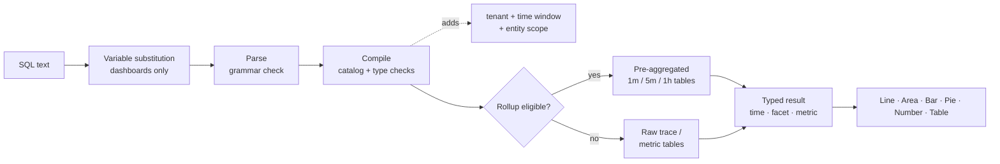

## Comment effectuer des requêtes avec SQL : les mécanismes d’interrogation {#how-to-query-with-sql-the-mechanics-of-querying}

Avant d’utiliser un outil, il est utile de savoir comment il fonctionne. Ce document explique comment explorer vos données, ce qui se produit lorsqu’une requête s’exécute et présente des exemples de requêtes, simples ou complexes.

### Exploration des données

La meilleure façon d’utiliser SQL est d’ouvrir **Explorer** et de l’essayer avec vos propres données.

>[!TIP]
>
> SQL est en lecture seule. Il ne peut pas modifier ni supprimer des données, et chaque requête est limitée à votre client.

1. **Sélectionnez un client** dans le sélecteur de client en haut de l’application, SQL a besoin d’un seul client.
2. Ouvrez **Explorer**. L’onglet **Visual Builder** vous permet de sélectionner **De** (une entité), **Agrégat**, **Filtres**, **Facette** et **Timeseries**. Le code SQL généré s’affiche en dessous.
3. Passez à l’onglet **SQL** pour modifier directement la requête. L’éditeur complète automatiquement les entités, les attributs et les fonctions au fur et à mesure que vous saisissez.
4. Ouvrez le panneau **Guide de requête** à droite pour parcourir les entités, les types d’attributs et les exemples de requêtes. Cliquez sur un exemple pour le charger.
5. Cliquez sur **Valider** pour vérifier une requête sans l’exécuter, ou sur **Exécuter** (⌘/Ctrl + Entrée) pour afficher les résultats.

Commencez par saisir `FROM` et par choisir une entité, puis ajoutez `SELECT` et un attribut :

```sql
FROM Transaction SELECT name, duration LIMIT 20
```

Il s’agit d’une requête **événement** de base. Elle renvoie 20 requêtes entrantes, indiquant le nom et la durée de chacune d’elles.

Remplacez maintenant les attributs par un **agrégat** et regroupez le résultat :

```sql
FROM Transaction SELECT count(*) FACET service
```

Cela comptabilise les requêtes par service, ce qui vous indique quels services génèrent des rapports.

>[!IMPORTANT]
>
> **Découvrir avant de créer.** La disponibilité des attributs dépend de la manière dont chaque service est instrumenté. Exécutez d’abord les [requêtes de découverte](#101-data-discovery) sur un nouveau client pour voir quels services, hôtes, attributs et mesures contiennent réellement des données.

### Exécution d’une requête

Lorsque vous exécutez une requête, Observability Insights :

1. **Substitue des variables**, en remplaçant les jetons de `{{name}}` par la sélection actuelle de la variable de tableau de bord. Cela se produit dans le navigateur, sur les tableaux de bord uniquement.
2. **Analyse** texte. Tout ce qui n’est pas de la grammaire SQL est rejeté, y compris les points-virgules, les fonctions SQL brutes et les sous-requêtes.
3. **Compile** la requête. Il mappe chaque attribut logique (par exemple `urlPath`) à son expression stockée et valide les types et les fonctions.
4. **Ajoute des protections obligatoires** : votre client, la fenêtre temporelle et la portée fixe de l’entité (par exemple, `Transaction` signifie que le serveur s’étend uniquement).
5. **Itinéraires** requêtes de série temporelle éligibles vers des tables **cumul** préagrégées. Cette opération est automatique et les résultats correspondent aux données brutes.
6. **Exécute** la requête avec un délai d’expiration de 15 secondes et un budget lu sur octets, puis renvoie les colonnes saisies (heure, facette, mesure) que l’interface utilisateur rend.



### Formes de résultat

Chaque requête renvoie l&#39;une des quatre formes. La forme décide quels graphiques sont pertinents.

| Forme | Comment tu l&#39;as eu | `LIMIT` par défaut | Meilleure visualisation |
| --------------- | ---------------------------------------------------- | --------------- | ------------------ |
| **Panneau publicitaire** | Agrégats uniquement, sans `FACET` ni `TIMESERIES` | 1 | Nombre |
| **Facette** | Agrégats + `FACET` | 10 | Barre, Secteurs, Tableau |
| **Série temporelle** | Agrégats + `TIMESERIES` (avec ou sans `FACET`) | 5 000 lignes | Ligne, Aire, Barre |
| **Événements** | Attributs bruts uniquement | 100 | Tableau |

<a id="time-window-precedence"></a>

### Priorité de la fenêtre temporelle

| Où s’exécute la requête | Quelle fenêtre s’applique ? |
| --------------------------------- | ---------------------------------------------------------------------------------- |
| **Widget de tableau de bord** | Tableau de bord **sélecteur d’heure**. Les `SINCE`/`UNTIL` de la requête sont ignorés. |
| **Ajouter un aperçu de widget** | Sélecteur de temps dans la boîte de dialogue **Ajouter un widget**. |
| **Explorer** | Sélecteur d’heure global. Les `SINCE`/`UNTIL` sont ignorés lorsqu’une plage de sélecteur est active. |
| **API sans plage explicite** | `SINCE`/`UNTIL` dans la requête, par défaut la dernière heure. |

>[!NOTE]
>
> Étant donné que le sélecteur gagne dans les tableaux de bord et dans Explorer, ce guide ne prend généralement pas en `SINCE` les requêtes des tableaux de bord. Il convient toujours de définir un sélecteur de l’heure pour les requêtes.
