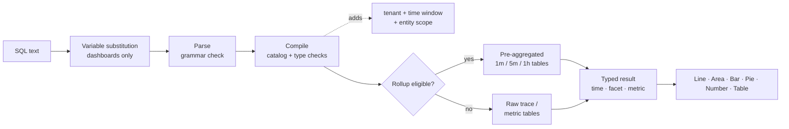

<a id="top"></a>

# Documentation sur le tableau de bord/la requête des insights d’observabilité d’Adobe

**Langage de requête d’Adobe Observability Insights (SQL)** — interroger, représenter sous forme de graphique et de tableau de bord votre télémétrie dans Adobe Observability Insights.

|                |                                                                  |
| -------------- | ---------------------------------------------------------------- |
| **S’applique à** | Interface utilisateur d’Insights → **Explorer** et **Tableaux de bord** (tableaux de bord personnalisés) |
| **Audience** | Ingénieurs, ingénieurs et utilisatrices et utilisateurs et utilisatrices expérimentés qui connaissent SQL |

>[!TIP]
> Chaque bloc de code marqué `sql` est une requête SQL que vous pouvez coller directement dans **Explorer → SQL** ou dans **Tableaux de bord → Ajouter un widget → SQL**.

## Mappage de la documentation

| Section | Doc | Ce que vous apprendrez : |
| --------------- | ----------------------------------------------------------------------------------- | ------------------------------------------------------------------------------------------- |
| **Commencer** | [1. Prise en main de SQL](#1-get-started-with-SQL-the-language-of-your-telemetry) | Ce qu’est SQL, ce que vous pouvez demander, où l’utiliser, les règles de base |
|                 | [2. Comment effectuer des requêtes avec SQL &#x200B;](#2-how-to-query-with-SQL-the-mechanics-of-querying) | Exploration des données, exécution d’une requête, exemples de travail |
|                 | [3. Tableaux de bord et graphiques](#3-charts-and-dashboards-visualizing-your-data) | Comment transformer des requêtes en graphiques et créer des tableaux de bord étape par étape |
| **Référence** | [4. Référence SQL &#x200B;](#4-SQL-reference) | Chaque clause, fonction et opérateur, avec des exemples |
|                 | [5. Dictionnaire de données &#x200B;](#5-data-dictionary) | Chaque entité et attribut que vous pouvez interroger |
| **Tutoriels** | [6. Tutoriel 1 : Vos premières requêtes](#6-tutorial-1-your-first-queries) | `SELECT`, `FROM`, `LIMIT`, agrégats, heure, `TIMESERIES`, `WHERE`, `FACET` |
|                 | [7. Tutoriel 2 : Contrôler vos données](#7-tutorial-2-control-your-data) | Valeurs uniques, au plus tard/au plus tôt, pourcentages, centiles, libellés, caractères génériques, classement |
|                 | [8. Tutoriel 3 : progresser dans votre tableau de bord](#8-tutorial-3-advance-your-dashboarding) | Agrégats conditionnels, Apdex, taux, histogrammes, formules, variables, sections |
|                 | [9. Didacticiel 4 : Fonctions avancées](#9-tutorial-4-advanced-functions) | `stddev`, `derivative`, `latest` de classement, part du total, composition d’étendue, découverte de mesures |
| **Exemples** | [10. Demander le guide pas à pas &#x200B;](#10-query-cookbook) | Plus de 100 requêtes prêtes à l’emploi par rubrique (y compris AEM) |
|                 | [11. Plans directeurs de tableaux de bord &#x200B;](#11-dashboard-blueprints) | Dix tableaux de bord complexes et complets avec la requête de chaque widget |
| **Fonctionner** | [12. Performances &#x200B;](#12-performance) | Cumuls, requêtes de budgets et comment garder les tableaux de bord rapides |
|                 | [13. Dépannage &#x200B;](#13-troubleshooting) | Chaque message d’erreur, ce qu’il signifie et comment le corriger |
|                 | [14. Annexe &#x200B;](#14-appendix) | Limites, format de fichier d’exportation, aide-mémoire d’une page |

&#x200B;# Commencer

## &#x200B;1. Prise en main de SQL : le langage de votre télémétrie

SQL est un langage de requête de type SQL pour vos données Observability Insights. Il s’agit de la même langue derrière chaque widget de tableau de bord personnalisé et la page **Explorer**, afin que vous puissiez créer les vues dont votre équipe a besoin.

SQL fonctionne avec des **entités**, qui sont des vues logiques conviviales telles que `Transaction`, `Span` ou `CpuUtilization`. Vous ne devez jamais interroger directement des tables de stockage. Observability Insights compile chaque requête SQL en une requête d’entrepôt de données paramétrée et sécurisée. Il étend toujours cette requête à votre client et à la fenêtre temporelle sélectionnée.

```sql
SELECT count(*) AS requests FROM Transaction TIMESERIES AUTO
```

### Utilisation de SQL

Utilisez SQL pour :

- **Créer des graphiques** du débit, du taux d’erreur, de la latence, d’Apdex, de CPU, de la mémoire, du tas JVM, du disque et du réseau au fil du temps.
- **Répondez à des questions spécifiques** telles que « Quels chemins d’URL au niveau de publication ont la pire p95 ? » ou « quel domaine en aval échoue ? »
- **Enquêter sur les incidents** en analysant en profondeur les requêtes individuelles et les ID de suivi, à partir d’un KPI.
- **Créer des tableaux de bord** avec des indicateurs clés de performance, des tendances, des tableaux, des formules, des notes, des en-têtes de section et des variables.
- **Charges de travail Profile AEM** (Adobe Experience Manager) à l’aide des attributs Sling, JSP, JCR, Dispatcher et GraphQL.

SQL prend en charge les requêtes **événement**, qui renvoient des lignes de requête individuelles, et les requêtes **agrégées**, qui renvoient des totaux, des centiles, des taux, des répartitions et des séries temporelles.

>[!TIP]
> Les modèles de **Tableaux de bord → Créer un tableau de bord** sont entièrement créés à partir de SQL. Ouvrez n’importe quel widget de modèle avec l’icône en forme de crayon pour afficher sa requête et en tirer des enseignements.

### Ce que vous pouvez interroger

SQL peut interroger quatre familles de données. La liste complète se trouve dans le [dictionnaire de données](#5-data-dictionary).

| Famille | Entités | Questions courantes |
| ------------------------------------ | ------------------------------------------------------------------------------------------------------------------------------------------------------------------ | -------------------------------------------------------------------- |
| **Traces (APM)** | `Transaction` (requêtes entrantes), `AppRequest` (requêtes + consommateurs de messages), `Span` (chaque étendue) | Débit, latence, erreurs, Apdex, appels en aval, chemins de code AEM |
| **Mesures d’exécution et d’hôte traitées** | `CpuUtilization`, `MemoryUtilization`, `LoadAverage5m`, `DiskUtilization`, `NetworkReceiveRate`, `JvmHeapUsed`, `JvmThreadCount`, `DispatcherRequestRate` et plus encore | Saturation, capacité, intégrité de JVM, charge du Dispatcher |
| **Mesures génériques** | `MetricGauge`, `MetricSum` | Toute mesure OpenTelemetry par nom, découverte de mesures |
| **Composition d’étendue préagrégée** | `SpanBreakdown` | Les opérations enfants qui constituent une transaction |

>[!NOTE]
> Les journaux, les définitions d’alerte et les relations d’inventaire ne sont pas disponibles.

### Où utiliser SQL

| Où : | Comment l’ouvrir | C&#39;est pour quoi ? |
| ----------------------- | ------------------------------------------------------------------------------ | ------------------------------------------------------------------------------------------------------------------------------------------------------------------------------------ |
| **Explorer** | Navigation de gauche → **Explorer** | Analyse ad hoc. Utilisez l&#39;onglet **Visual Builder** ou **SQL**, **Valider**, puis **Exécuter** (⌘/Ctrl + Entrée). Comprend des requêtes **Historique** et **Enregistrées** ainsi qu’un panneau **Guide de requête**. |
| **Tableaux de bord** | La navigation de gauche → **Tableaux de bord** → ouvrir ou créer un tableau de bord → **Ajouter un widget** | Graphiques, KPI et tableaux persistants, combinés en tableaux de bord. |
| **Widgets de formule** | **Ajouter un widget → une formule** | Combinez 2 à 6 requêtes SQL avec des opérations arithmétiques (ratios, headroom, taux de combustion). |
| **Variables de tableau de bord** | **+ Variable → d’une requête** | Renseignez un sélecteur à partir des valeurs distinctes d’une requête SQL `FACET`. |
| **Inspection des requêtes** | Survoler un graphique → inspecter la requête | Affichez le code SQL sous-jacent à un graphique intégré ou de tableau de bord. |

### Structure de requête SQL

SQL suit une syntaxe basée sur des clauses. Cette requête comptabilise toutes les demandes entrantes dans la fenêtre sélectionnée :

```sql
SELECT count(*) FROM Transaction
```

Voici toutes les clauses disponibles :

```text
SELECT  function(attribute) [FILTER (WHERE condition)] [AS alias] [, ...]
        | attribute [AS alias] [, ...]
FROM    Entity
  [WHERE      condition [AND | OR ...]]
  [FACET      attribute [, attribute ...]]        -- up to 5
  [SINCE      n unit [AGO]]
  [UNTIL      NOW | n unit [AGO]]
  [TIMESERIES AUTO | MAX | n unit]
  [ORDER BY   alias [ASC | DESC]]
  [LIMIT      number]                              -- 1 to 5000
```

Les règles SQL sont les suivantes :

| Règle | Détails |
| ---------------------------- | ------------------------------------------------------------------------------------------------------------------------------------------------------------------------------------ |
| **Clauses obligatoires** | `SELECT` et `FROM` sont requis. Toutes les autres clauses sont facultatives. Vous pouvez commencer par : `FROM Transaction SELECT count(*)` est également valide. |
| **Ordre des clauses** | Les clauses après `FROM` peuvent apparaître dans n’importe quel ordre. Chaque clause ne peut apparaître qu&#39;une seule fois. |
| **Taille de la requête** | Une requête doit faire 4 Ko ou moins. |
| **Respect de la casse** | Les mots-clés, noms de fonction, noms d’entité et noms d’attribut ne respectent **pas** la casse. Valeurs de chaîne **sont sensibles** la casse (`'Error'` ≠ `'error'`). |
| **chaînes** | Utilisez des guillemets simples : `WHERE status = 'Error'`. Pour inclure une citation, doublez-la : `'O''Brien'`. Les guillemets doubles ne sont pas acceptés. |
| **Littéraux** | Chaînes, nombres (y compris négatifs et décimaux), `TRUE`, `FALSE`, `NULL`. |
| **Noms d’attributs** | Les noms peuvent contenir des lettres, des chiffres, des `_` et des `.` (par exemple, `http.statusCode`). Pas besoin de backticks. |
| **Agrégats et attributs** | Une requête sélectionne des attributs bruts (une liste d’événements) ou des agrégats, jamais les deux. Pour regrouper, utilisez `FACET`. |
| **Période** | La valeur par défaut est la dernière heure. La durée maximale est de 31 jours. Dans les tableaux de bord et dans Explorer, le **sélecteur d’heure** définit la fenêtre (voir [Fenêtre temporelle](#time-window-precedence)). |
| **Non pris en charge** | Points-virgules, commentaires, sous-requêtes, jointures, `SELECT *`, correspondance entre les attributs dans `SELECT`, `HAVING`, `COMPARE WITH`. Voir [Ce que SQL ne fait pas](#what-SQL-doesnt-do) pour d’autres solutions. |

### Étapes suivantes

- [Comment effectuer des requêtes avec SQL &#x200B;](#2-how-to-query-with-SQL-the-mechanics-of-querying) : explorez les données et comprenez comment les requêtes s’exécutent.
- [Tableaux de bord et graphiques](#3-charts-and-dashboards-visualizing-your-data) : visualisez vos résultats.
- [Tutoriel 1 : Vos premières requêtes](#6-tutorial-1-your-first-queries) : une présentation pratique.
- [Référence SQL](#4-SQL-reference) : syntaxe complète, clauses et fonctions.

[↑ Haut de la page](#top)

## &#x200B;2. Comment effectuer des requêtes avec SQL : les mécanismes d’interrogation

Avant d’utiliser un outil, il est utile de savoir comment il fonctionne. Ce document explique comment explorer vos données, ce qui se produit lorsqu’une requête s’exécute et présente des exemples de requêtes, simples ou complexes.

### Exploration des données

La meilleure façon d’utiliser SQL est d’ouvrir **Explorer** et de l’essayer avec vos propres données.

>[!TIP]
> SQL est en lecture seule. Il ne peut pas modifier ni supprimer des données, et chaque requête est limitée à votre client.

1. **Sélectionnez un client** dans le sélecteur de client en haut de l’application, SQL a besoin d’un seul client.
2. Ouvrez **Explorer**. L’onglet **Visual Builder** vous permet de sélectionner **De** (une entité), **Agrégat**, **Filtres**, **Facette** et **Timeseries**. Le code SQL généré s’affiche en dessous.
3. Passez à l’onglet **SQL** pour modifier directement la requête. L’éditeur complète automatiquement les entités, les attributs et les fonctions au fur et à mesure que vous saisissez.
4. Ouvrez le panneau **Guide de requête** à droite pour parcourir les entités, les types d’attributs et les exemples de requêtes. Cliquez sur un exemple pour le charger.
5. Cliquez sur **Valider** pour vérifier une requête sans l’exécuter, ou sur **Exécuter** (⌘/Ctrl + Entrée) pour afficher les résultats.

Commencez par saisir `FROM` et par choisir une entité, puis ajoutez `SELECT` et un attribut :

```sql
FROM Transaction SELECT name, duration LIMIT 20
```

Il s’agit d’une requête **événement** de base. Elle renvoie 20 requêtes entrantes, indiquant le nom et la durée de chacune d’elles.

Remplacez maintenant les attributs par un **agrégat** et regroupez le résultat :

```sql
FROM Transaction SELECT count(*) FACET service
```

Cela comptabilise les requêtes par service, ce qui vous indique quels services génèrent des rapports.

>[!IMPORTANT]
> **Découvrir avant de créer.** La disponibilité des attributs dépend de la manière dont chaque service est instrumenté. Exécutez d’abord les [requêtes de découverte](#101-data-discovery) sur un nouveau client pour voir quels services, hôtes, attributs et mesures contiennent réellement des données.

### Exécution d’une requête

Lorsque vous exécutez une requête, Observability Insights :

1. **Substitue des variables**, en remplaçant les jetons de `{{name}}` par la sélection actuelle de la variable de tableau de bord. Cela se produit dans le navigateur, sur les tableaux de bord uniquement.
2. **Analyse** texte. Tout ce qui n’est pas de la grammaire SQL est rejeté, y compris les points-virgules, les fonctions SQL brutes et les sous-requêtes.
3. **Compile** la requête. Il mappe chaque attribut logique (par exemple `urlPath`) à son expression stockée et valide les types et les fonctions.
4. **Ajoute des protections obligatoires** : votre client, la fenêtre temporelle et la portée fixe de l’entité (par exemple, `Transaction` signifie que le serveur s’étend uniquement).
5. **Itinéraires** requêtes de série temporelle éligibles vers des tables **cumul** préagrégées. Cette opération est automatique et les résultats correspondent aux données brutes.
6. **Exécute** la requête avec un délai d’expiration de 15 secondes et un budget lu sur octets, puis renvoie les colonnes saisies (heure, facette, mesure) que l’interface utilisateur rend.



### Formes de résultat

Chaque requête renvoie l&#39;une des quatre formes. La forme décide quels graphiques sont pertinents.

| Forme | Comment tu l&#39;as eu | `LIMIT` par défaut | Meilleure visualisation |
| --------------- | ---------------------------------------------------- | --------------- | ------------------ |
| **Panneau publicitaire** | Agrégats uniquement, sans `FACET` ni `TIMESERIES` | 1 | Nombre |
| **Facette** | Agrégats + `FACET` | 10 | Barre, Secteurs, Tableau |
| **Série temporelle** | Agrégats + `TIMESERIES` (avec ou sans `FACET`) | 5 000 lignes | Ligne, Aire, Barre |
| **Événements** | Attributs bruts uniquement | 100 | Tableau |

<a id="time-window-precedence"></a>

### Priorité de la fenêtre temporelle

| Où s’exécute la requête | Quelle fenêtre s’applique ? |
| --------------------------------- | ---------------------------------------------------------------------------------- |
| **Widget de tableau de bord** | Tableau de bord **sélecteur d’heure**. Les `SINCE`/`UNTIL` de la requête sont ignorés. |
| **Ajouter un aperçu de widget** | Sélecteur de temps dans la boîte de dialogue **Ajouter un widget**. |
| **Explorer** | Sélecteur d’heure global. Les `SINCE`/`UNTIL` sont ignorés lorsqu’une plage de sélecteur est active. |
| **API sans plage explicite** | `SINCE`/`UNTIL` dans la requête, par défaut la dernière heure. |

>[!NOTE]
> Étant donné que le sélecteur gagne dans les tableaux de bord et dans Explorer, ce guide ne prend généralement pas en `SINCE` les requêtes des tableaux de bord. Il convient toujours de définir un sélecteur de l’heure pour les requêtes.

### Exemples de requêtes SQL

Voici un exemple plus complet. Pour cette requête :

- Vous choisissez `Transaction` comme entité.
- Vous utilisez `SELECT` pour calculer la durée du 95e centile.
- Vous regroupez les résultats par service avec `FACET`.
- Vous utilisez `TIMESERIES AUTO` pour tracer les données sur un intervalle automatiquement dimensionné.

```sql
FROM Transaction SELECT percentile(duration, 95) AS p95 FACET service TIMESERIES AUTO
```

Cela génère une ligne par service sur un graphique linéaire, avec les 10 services les plus occupés affichés par défaut.

Cliquez sur chaque exemple ci-dessous pour le développer.

<details>
<summary><strong>Requête de base des requêtes entrantes</strong></summary>

Temps de réponse moyen, en millisecondes, de toutes les requêtes entrantes :

```sql
SELECT average(duration) FROM Transaction
```

</details>

<details>
<summary><strong>Noms d’attributs contenant des points</strong></summary>

Les noms en pointillés n’ont pas besoin de guillemets :

```sql
SELECT count(*) FROM Transaction WHERE http.statusCode >= 500 FACET http.route
```

</details>

<details>
<summary><strong>Requête renvoyant plusieurs colonnes</strong></summary>

Plusieurs agrégats dans une requête deviennent des colonnes dans un tableau :

```sql
SELECT count(*) AS requests, average(duration) AS avgMs, percentile(duration, 95) AS p95, max(duration) AS maxMs FROM Transaction FACET service
```

</details>

<details>
<summary><strong>Agrégats conditionnels en une seule passe</strong></summary>

Total, erreurs et 5xx côte à côte :

```sql
SELECT count(*) AS total, count(*) FILTER (WHERE status = 'Error') AS errors, count(*) FILTER (WHERE http.statusCode >= 500) AS http5xx FROM Transaction FACET service
```

</details>

<details>
<summary><strong>Requête d’une mesure sélectionnée</strong></summary>

CPU moyen par hôte au fil du temps :

```sql
SELECT average(value) AS cpu FROM CpuUtilization FACET host TIMESERIES AUTO
```

</details>

<details>
<summary><strong>Requête d’une mesure OpenTelemetry par nom</strong></summary>

Utilisez `MetricGauge` / `MetricSum` pour les mesures sans entité curée :

```sql
SELECT latest(value) AS bytesUsed FROM MetricSum WHERE metric = 'jvm.memory.used' FACET host, pool
```

</details>

<a id="what-SQL-doesnt-do"></a>

### Ce que SQL ne fait pas

SQL est délibérément petit. Cela permet de garder les requêtes sécurisées, rapides et isolées par le client ou la cliente. Lorsque vous avez besoin de l’une de ces fonctionnalités, utilisez l’alternative .

| Fonction | Statut | Alternative |
| ------------------------------------------- | ------------- | ------------------------------------------------------------------------------------------------------------ |
| `SELECT *` | Non pris en charge. | Répertoriez les attributs souhaités : `SELECT timestamp, name, duration, traceId …`. |
| Mélange d’attributs bruts et d’agrégats | Non pris en charge. | Utilisez `FACET attr` ou `latest(attr)` / `earliest(attr)`. |
| Mathématiques en `SELECT` (`a - b`, `count(*) / 60`) | Non pris en charge. | **Formule** widget (tableaux de bord). |
| Jointures et sous-requêtes | Non pris en charge. | **Formule** widget ou deux widgets côte à côte. |
| `HAVING` | Non pris en charge. | `ORDER BY alias` + `LIMIT`. |
| `COMPARE WITH` | Non pris en charge. | Modifiez le sélecteur d’heure ou placez deux widgets sur des onglets différents. |
| `FACET CASES` | Non pris en charge. | Une colonne `count(*) FILTER (WHERE …)` par cas (voir [Tutoriel 3](#83-group-values-into-cases-with-filter)). |
| `histogram()` | Non pris en charge. | Colonnes `FILTER` regroupées (voir [tutoriel 3](#84-build-a-latency-histogram)). |
| `uniques()` / `keyset()` | Non pris en charge. | `FACET attr LIMIT n` répertorie des valeurs distinctes. Les requêtes de découverte répertorient les mesures et les attributs renseignés. |
| `RLIKE` (regex) | Non pris en charge. | `LIKE` / `NOT LIKE` avec des caractères génériques `%` et `_`, ou `IN (…)`. |
| Commentaires (`--`, `//`, `/* */`) | Non pris en charge. | Insérez des notes dans le titre du widget ou dans un widget **Texte**. |
| Dates absolues en `SINCE` | Non pris en charge. | Utilisez la plage absolue du sélecteur d’heure. |
| Conversion de type (`numeric()`, `string()`) | Pas nécessaire | Les attributs sont saisis dans le catalogue. |

[↑ Haut de la page](#top)

## &#x200B;3. Tableaux de bord et graphiques : visualisation des données

Les requêtes trouvent les informations dont vous avez besoin. Les graphiques et les tableaux de bord rendent ces informations utiles à votre organisation. Ce document explique comment les résultats SQL deviennent des graphiques et comment créer, organiser et partager des tableaux de bord.

### Graphiques

Chaque résultat SQL peut être rendu sous l’un des six types de graphique.

| Type de graphique | Utilisez-le pour | Forme de requête |
| --------------- | --------------------------------------------------- | ----------------------------------------------- |
| **Ligne** | Tendances dans le temps ; une ligne par valeur de facette | Agrégat + `TIMESERIES` |
| **Zone** | Volume au fil du temps, par exemple débit par service | Agrégat + `TIMESERIES` |
| **Barre** | Comparaison de catégories ; séries temporelles éparses | Agrégat + `FACET` (± `TIMESERIES`) |
| **circulaire/anneau** | Part d’un tout (mix de codes d’état, trafic par niveau) | Un agrégat + `FACET`, quelques valeurs |
| **Nombre** | Un KPI unique, avec des seuils de couleur facultatifs | Panneau d’affichage (agrégats uniquement) |
| **Tableau** | Agrégats multiples par groupe ou listes d’événements | Plusieurs agrégats + `FACET` ou attributs bruts |

Une fois qu’un widget est sur un tableau de bord, vous pouvez :

- **Modifier** sa requête, son titre, son type de graphique et son unité (icône de crayon).
- **Dupliquer** permet de créer une variante, telle que le même graphique pour un autre niveau.
- **Télécharger CSV** des lignes actives ou **PNG** à la résolution 2×.
- **Faites-le glisser** à côté de la poignée et **redimensionnez** à partir du coin inférieur droit.

### Tableaux de bord

Les graphiques fonctionnent bien par eux-mêmes, mais les tableaux de bord les rassemblent. Un tableau de bord est une collection d’**onglets** nommée et étendue au client. Chaque onglet est une grille de 12 colonnes de **widgets**.

| Concept | Signification |
| --------------- | ------------------------------------------------------------------------------------------------------------------------------- |
| **Tableau de bord** | Collection nommée de 1 à 40 onglets, stockée côté serveur pour le client sélectionné. |
| **Onglet** | Une grille de widgets (jusqu’à 200). Renommez-le avec le crayon, supprimez-le avec ×, ajoutez-en un avec **+**. Il doit rester au moins un onglet. |
| **Widget** | **requête unique**, **formule** ou **texte** (en-tête de section réductible ou de note). |
| **Variable** | Un sélecteur au-dessus de la grille. Sa valeur est injectée en tant que `{{name}}`. |
| **Sélecteur d’heure** | La fenêtre pour chaque widget du tableau de bord. |

### Créer un tableau de bord, étape par étape

#### Étape 1 : Avant de commencer

- **Sélectionnez un seul client** dans le sélecteur de client. **Créer un tableau de bord** est désactivé lorsque **Tous les comptes** est sélectionné. SQL ne peut pas s&#39;exécuter sur le client de démonstration.
- **Roles.** Toute personne disposant d’un accès aux tableaux de bord peut ajouter, modifier et enregistrer des widgets. La création ou la modification de **variables** et l’inspection de la requête d’un widget se limitent aux **administrateurs d’organisation** et **super administrateurs**.

#### Étape 2 : créer le tableau de bord

1. Ouvrez **Tableaux de bord** dans le volet de navigation de gauche.
2. Cliquez sur **Créer un tableau de bord**.
3. Choisissez un point de départ :

   | Option | Ce que vous obtenez |
   | ---------------------------- | -------------------------------------------------------------------------------------------------------- |
   | **Créer un tableau de bord personnalisé** | Tableau de bord vide avec un seul onglet. |
   | **Concepts de base de** | CPU de l’hôte et du processus (utilisateur/système/iowait/steal), débit, chargement, Apdex. |
   | **Présentation tout-en-un** | KPI (volume, pourcentage d’erreur, Apdex, p95), secteurs d’erreur/de trafic, tables CPU/de mémoire, threads JVM, opérations lentes. |
   | **Principales transactions** | Apdex, p95 par opération, chargement par hôte/CPU, transactions les plus lentes avec ID de trace, répartition des erreurs HTTP. |

4. Saisissez un **nom** et confirmez. La zone de travail du tableau de bord s’ouvre.

#### Étape 3 : Découvrir la zone de travail

| Domaine | Contrôles |
| ---------------------------- | --------------------------------------------------------------------------------------------------------- |
| **Barre supérieure** | **Ajouter un widget**, **Guide** (aide-mémoire intégré à l’application), **Importer**, **Exporter**, **Enregistrer**, sélecteur d’heure et actualisation |
| **Barre variable** | Badge client, un sélecteur par variable, **+ Variable** (administrateurs) |
| **Barre de tabulation** | Basculer entre les onglets ; renommer (crayon), supprimer (×), ajouter (+) |
| **Grille** | 12 colonnes. Faites glisser les widgets près de la poignée, redimensionnez-les depuis le coin (minimum 2×2). |
| **En-tête du widget** (au survol) | Télécharger CSV, Télécharger PNG, Modifier, Dupliquer, Supprimer, faire glisser la poignée |

>[!IMPORTANT]
> **L’enregistrement est explicite.** Les modifications de disposition, les nouveaux widgets, onglets et variables restent dans votre navigateur jusqu’à ce que vous cliquiez sur **Enregistrer**. Le bouton indique _Enregistrement... → enregistré_ ou _Échec de l’enregistrement_ (voir [Dépannage](#13-troubleshooting)).

#### Étape 4 : ajouter un widget

Cliquez sur **Ajouter un widget**. La boîte de dialogue comporte trois modes : **Requête unique**, **Formule** et **Texte**. Il dispose également de son propre sélecteur d’heure. Vous pouvez donc prévisualiser le widget sur n’importe quelle fenêtre.

**Option A : le Builder (pas de code)**

1. _(Facultatif)_ **Commencez par un assistant** : choisissez l’un des 57 paramètres prédéfinis, regroupés sous la forme de signaux d’or, APM, AEM, Transactions, Traces et étendues, Infrastructure, Éditeurs, JVM et runtime et Découverte de données. Un préréglage remplit le titre, la requête, le type de graphique et l’unité.
2. **Afficher** : sélectionnez `Count`, `Average`, `Percentile` (et son niveau), `Sum`, `Min`, `Max` ou `Unique count`, puis un attribut.
3. **de** : sélectionnez l’entité.
4. **Filtre** : ajoutez des lignes de `attribute operator value` (`=`, `!=`, `>`, `<`, `>=`, `<=`, `LIKE`). Toutes les lignes sont combinées avec `AND`.
5. **Regrouper par** : choisissez un attribut de facette, puis **N en haut** pour ne conserver que la série la plus occupée.
6. **Au fil du temps** : active `TIMESERIES`, avec une taille de compartiment **toutes les N minutes**.
7. Vérifiez le code SQL généré sous le formulaire, puis cliquez sur **Exécuter la requête**.

**Option B : éditeur SQL**

1. Basculez le bouton (bascule) de **Builder** vers **SQL**. La modification d’un widget existant s’ouvre toujours dans SQL.
2. Saisissez ou collez une requête. L’éditeur complète automatiquement à partir du catalogue dynamique.
3. Utilisez le panneau **Guide de requête** pour parcourir les entités, les attributs et les exemples.
4. Cliquez sur **Exécuter la requête**. Vous verrez _`<Entity>`requête est valide_ un aperçu en direct et un résumé (`N rows · N time points · N groups`). Un avertissement _série clairsemée_ s’affiche lorsqu’il y a moins de trois points temporels.

>[!TIP]
> Le Builder couvre les requêtes les plus courantes. Basculez vers SQL pour `apdex`, `percentage`, `rate`, `FILTER`, plusieurs agrégats, `OR`, `IN`, plusieurs facettes ou `ORDER BY`.

#### Étape 5 : Configurer l’apparence

| Champ | Remarques |
| --------------------- | ----------------------------------------------------------------------------------------------------------------------------------------------------------------------- |
| **Titre** | Jusqu’à 200 caractères. Peut contenir des jetons `{{variable}}`. |
| **Type de graphique** | `Line`, `Area`, `Bar`, `Pie / Donut`, `Number`, `Table`. Un type de graphique est recommandé après chaque exécution jusqu’à ce que vous en choisissiez un vous-même. |
| **Unité** | Facultatif ; jusqu’à 40 caractères (`ms`, `%`, `req/s`, `MB`, `bytes`). Laissez vide pour utiliser l’unité déduite (par exemple `ms` pour `duration`, `%` pour `CpuUtilization`). |
| **Seuils de couleur** | Widgets numériques uniquement. Jusqu&#39;à 10 bandes de la forme _au `value` ou plus → Vert/Jaune/Rouge_. La bande correspondante la plus élevée gagne. |

#### Étape 6 : enregistrer le widget, puis le tableau de bord

Le **widget d’enregistrement** n’est activé qu’après le renvoi des données par une exécution. Les nouveaux widgets comportent 6 colonnes × 3 lignes et sont compressés à raison de deux par ligne. Organisez-les, puis cliquez sur **Enregistrer** dans la barre supérieure.

### Choisir le bon graphique

| Forme de requête | Meilleur graphique | Pourquoi ? |
| ------------------------------------------------- | ------------------- | ---------------------------------------------- |
| Un agrégat, pas de `FACET`, pas de `TIMESERIES` | **Nombre** | Une mosaïque d’indicateurs de performance clés unique ; ajoutez des seuils. |
| Agrégat + `TIMESERIES` | **Ligne** / **Zone** | Une tendance ; une série par valeur de facette. |
| Agrégat + `FACET` (quelques valeurs) | **Barre** / **Secteurs** | Compare les catégories ; secteur pour part d&#39;ensemble. |
| Plusieurs agrégats + `FACET` | **Tableau** | Chaque agrégat devient une colonne. |
| Attributs bruts | **Tableau** | Une liste d’événements. |
| Agrégat + `FACET` + `TIMESERIES` sur des données éparses | **Barre** | Lit mieux que des lignes joyeuses. |

Lorsque la ligne unique d’un widget Nombre contient une valeur de texte (par exemple `latest(host)`), le widget l’affiche sous forme de sous-titre.

### Widgets de texte : notes et en-têtes de section

**Ajouter un widget → Texte** :

- **Remarque** : texte brut (jusqu’à 4 000 caractères, lignes vides conservées). Utilisez-le pour les liens de runbook, les propriétaires et les définitions de SLO. Les `{{variables}}` sont rendues.
- **En-tête de section** : cochez la case _En-tête de section_. Il s’étend sur toute la largeur et son chevron réduit chaque widget situé en dessous, jusqu’à l’en-tête de section suivant. Utilisez-le pour des regroupements tels que **PUBLICATION**, **AUTEUR** et **DISPATCHER**.

>[!TIP]
> Les titres des widgets se terminant par `- PUBLISH` ou `- AUTHOR` reçoivent une indice de couleur subtil, ce qui facilite la numérisation des tableaux de bord AEM par niveau.

### Sélecteur d’heure

- Il définit la fenêtre pour **chaque** widget et pour les options de variable pilotée par les requêtes.
- Il remplace `SINCE` / `UNTIL` dans les requêtes de widget.
- La fenêtre maximale est de **31 jours**.
- `TIMESERIES AUTO` adapte sa taille de compartiment à la fenêtre.
- Le sous-titre de chaque widget affiche la fenêtre réellement appliquée ; par exemple, _Depuis il y a 1 heure_.
- Les résultats sont mis en cache pendant 30 secondes. Utilisez le bouton d’actualisation pour forcer une nouvelle exécution.

### Variables

Les variables permettent à un tableau de bord de servir de nombreux contextes, tels qu’un service, un environnement ou un seuil à la fois. Ils sont abordés en détail dans le [tutoriel 3](#87-make-dashboards-reusable-with-variables).

>[!WARNING]
> **Limites connues dans la version actuelle :** `{{variables}}` fonctionner dans les widgets **titres** et **texte**. Dans le widget **SQL**, le rendu est effectué sur le tableau de bord, mais la prévisualisation **Ajouter un widget** et la prévisualisation **Enregistrer** côté serveur vérifient et rejettent le jeton `{{name}}` brut avec `Unexpected character '{'`. Tant que ce problème n’est pas résolu, utilisez des valeurs littérales dans les requêtes de widget et utilisez **Dupliquer** pour créer des variantes.

### Widgets de formule

Une formule combine de 2 à 6 requêtes SQL nommées de manière arithmétique, par exemple `(errors / total) * 100`. Utilisez-en une lorsqu’un indicateur de performance clé nécessite plusieurs requêtes, par exemple un ratio, une marge, une somme de taux ou un taux de combustion. Voir [&#x200B; Tutoriel 3](#86-combine-queries-with-formula-widgets).

### Partager, exporter et importer

| Action | Effets |
| ------------- | ------------------------------------------------------------------------------------------------------------------------------------------------------------------------- |
| **Enregistrer** | Conserve le nom, les onglets, les widgets, la disposition et les variables. Chaque requête de widget est revalidée côté serveur ; un widget non valide ne parvient pas à effectuer l’enregistrement complet. |
| **Exporter** | Téléchargements `<dashboard-name>.json` (onglets, widgets, variables). |
| **Importer** | Charge une exportation JSON **dans le tableau de bord ouvert** en remplaçant ses onglets et variables. Cliquez ensuite sur **Enregistrer**. Conseil : créez d’abord un tableau de bord vide, puis importez-le. |
| **CSV/PNG** | Téléchargements par widget à partir de l’en-tête du widget. |

>[!TIP]
> L’exportation et l’importation vous permettent de contrôler les versions des tableaux de bord dans Git et de promouvoir un tableau de bord d’un client à un autre. Le format du fichier est décrit dans l’[Annexe](#142-export-file-format).

### Conseils pour optimiser les performances des tableaux de bord et des graphiques

- **Utilisez des tableaux pour les jeux de résultats volumineux** au lieu de barres ou de lignes de séries multiples.
- **Fractionner les tableaux de bord occupés en onglets.** Seuls les widgets de l’onglet visible s’exécutent.
- **Toujours `LIMIT` les requêtes à facettes**, en particulier sur les attributs à cardinalité élevée tels que `urlPath`, `traceId` et `jcr.path`.
- **Filtrez tôt** sur les attributs de faible cardinalité (`service`, `kind`, `status`).
- **Préférez les`TIMESERIES AUTO`** aux petits compartiments fixes et évitez les `TIMESERIES MAX` sauf pendant quelques minutes.
- **Concevoir des tendances à long terme pour les cumuls.** Voir [Performances](#12-performance).

[↑ Haut de la page](#top)

&#x200B;# Référence

## &#x200B;4. Référence SQL

Cette référence couvre la syntaxe SQL, les clauses, les fonctions et les opérateurs. Développez chaque entrée pour obtenir des détails et des exemples.

**Dans ce document :** [Composants de requête](#41-query-components) · [Clauses requises](#42-required-clauses) · [Clauses facultatives](#43-optional-clauses) · [Fonctions d’agrégateur](#44-aggregator-functions) · [Opérateurs et conditions](#45-operators-and-conditions) · [Gestion du type](#46-type-handling-blank-vs-null) · [SQL vers SQL](#47-translate-sql-to-SQL) · [NRQL vers SQL](#48-translate-nrql-to-SQL)

### 4.1 Composants de requête

```text
SELECT <select-item> [, <select-item> ...]
FROM   <Entity>
[WHERE      <condition>]
[FACET      <attribute> [, <attribute> ...]]          -- up to 5
[SINCE      <n> <unit> [AGO]]
[UNTIL      NOW | <n> <unit> [AGO]]
[TIMESERIES AUTO | MAX | <n> <unit>]
[ORDER BY   <alias-or-selected-name> [ASC | DESC]]
[LIMIT      <1..5000>]

<select-item> := <function>(<args>) [FILTER (WHERE <condition>)] [AS <alias>]
               | <attribute> [AS <alias>]
<unit>        := second | seconds | minute | minutes | hour | hours | day | days | week | weeks
```

>[!NOTE]
> Les annotations `--` ci-dessus sont uniquement de la documentation. SQL lui-même n&#39;accepte pas les commentaires.

### 4.2 Clauses obligatoires

<details>
<summary><code>SELECT</code> — que retourner</summary>

`SELECT` répertorie **attributs bruts** (requête d’événement) ou **fonctions d’agrégation** (requête d’agrégation). On ne peut pas mélanger les deux.

| Formulaire | Exemple | Résultat |
| ------------ | -------------------------------------------------- | ------------------------------------------------- |
| Attributs | `SELECT timestamp, name, duration` | Lignes d’événements individuels (100 par défaut) |
| Agrégats | `SELECT count(*), average(duration)` | Une valeur par agrégat (par facette/intervalle) |
| Avec des alias | `SELECT count(*) AS requests` | `requests` du libellé de la colonne |
| Alias cité | `SELECT percentile(duration, 95) AS 'p95 latency'` | Libellé avec espaces |

Liste des événements :

```sql
SELECT timestamp, service, name, duration, status, traceId FROM Transaction WHERE status = 'Error' LIMIT 50
```

Plusieurs agrégats :

```sql
SELECT count(*) AS requests, average(duration) AS avgMs, max(duration) AS maxMs FROM Transaction
```

Règles :

- `SELECT *` n’est pas pris en charge. Répertoriez les attributs souhaités.
- Les correspondances entre attributs ou agrégats (`sum(a) / count(*)`) ne sont pas prises en charge. Utilisez un [widget de formule](#86-combine-queries-with-formula-widgets).
- Le mélange des attributs et des agrégats échoue avec _Les attributs bruts ne peuvent pas être mélangés avec des agrégats ; utilisez la facette pour regrouper les résultats_.

</details>

<details>
<summary><code>FROM</code> : entité à interroger</summary>

`FROM` noms exacts **un** entité du [dictionnaire de données](#5-data-dictionary). Le nom de l’entité n’est pas sensible à la casse.

```sql
SELECT count(*) FROM Transaction
```

```sql
FROM Span SELECT count(*) FACET kind
```

Chaque entité possède une portée fixe. Par exemple, `Transaction` correspond toujours à l’étendue du serveur et `CpuUtilization` correspond toujours à la mesure CPU occupé avec `value` converti en pourcentage. Vous ne pouvez pas interroger plus d&#39;une entité dans une seule requête. Pour combiner des entités, utilisez un [widget de formule](#86-combine-queries-with-formula-widgets).

</details>

### 4.3 Clauses facultatives

<details>
<summary><code>AS</code> — étiqueter une colonne</summary>

Utilisez `AS` pour donner à un agrégat ou à un attribut un nom lisible. L’alias devient l’en-tête de colonne, le libellé de légende et le nom que vous référencez dans `ORDER BY`.

```sql
SELECT count(*) AS requests, percentile(duration, 95) AS p95 FROM Transaction FACET service ORDER BY p95 DESC LIMIT 10
```

Utilisez une chaîne entre guillemets simples pour les libellés comportant des espaces :

```sql
SELECT percentile(duration, 95) AS 'p95 latency (ms)' FROM Transaction TIMESERIES AUTO
```

</details>

<details>
<summary><code>FACET</code> — résultats du groupe</summary>

`FACET` regroupe les résultats en fonction d’attributs **5** maximum, tels que les `GROUP BY` SQL.

```sql
SELECT count(*) FROM Transaction FACET service, http.method, http.statusCode LIMIT 30
```

| Requête | Ce que `LIMIT n` signifie | Par défaut |
| ---------------------------- | ----------------------------------------------------------------------------------------------------------------------------- | --------------------------------- |
| `FACET` sans `TIMESERIES` | Nombre de lignes | 10 |
| `FACET` avec `TIMESERIES` | **N premières séries**, classées par la somme du premier agrégat sur l’ensemble de la fenêtre. Chaque intervalle est conservé pour ces séries. | Toutes les séries (avec une limite de 5 000 lignes) |

Série temporelle à facettes, top 5 :

```sql
SELECT count(*) AS requests FROM Transaction FACET service TIMESERIES AUTO LIMIT 5
```

Les valeurs de facettes peuvent être des chaînes ou des nombres. Les chaînes vides forment leur propre groupe. Les exclure avec `WHERE attr != ''`.

</details>

<details>
<summary><code>FILTER</code> — agrégats conditionnels</summary>

Ajoutez des `FILTER (WHERE condition)` à n’importe quel agrégat pour le calculer sur un sous-ensemble de lignes. Vous pouvez ainsi comparer plusieurs conditions en une seule passe.

```sql
SELECT count(*) AS total, count(*) FILTER (WHERE status = 'Error') AS errors, percentile(duration, 95) FILTER (WHERE http.method = 'GET') AS getP95 FROM Transaction FACET service LIMIT 20
```

`FILTER` n’est pas autorisé avec `apdex`, `rate` ou `derivative`. `percentage` prend déjà sa propre condition.

</details>

<details>
<summary><code>LIMIT</code> : nombre de lignes ou de séries</summary>

`LIMIT` prend un entier positif. Les valeurs supérieures à 5 000 sont fixées à 5 000.

| Forme du résultat | Par défaut |
| ------------ | ---------- |
| Panneau D&#39;Affichage | 1 |
| Facette | 10 |
| Série temporelle | 5 000 lignes |
| Événements | 100 |

```sql
SELECT count(*) FROM Transaction FACET urlPath LIMIT 50
```

>[!TIP]
> Définissez toujours un `LIMIT` sur les variables pilotées par les requêtes et sur les facettes de cardinalité élevée (`urlPath`, `traceId`, `jcr.path`, `url`).

</details>

<details>
<summary><code>ORDER BY</code> — trier les résultats</summary>

`ORDER BY` trie selon un **alias sélectionné ou attribut sélectionné**. La direction par défaut est `DESC`.

```sql
SELECT count(*) AS requests, percentile(duration, 95) AS p95 FROM Transaction FACET name ORDER BY p95 DESC LIMIT 20
```

| Forme du résultat | Ordre par défaut |
| ----------------- | --------------------------------------------------------------------------- |
| Panneau publicitaire / facette | Premier agrégat, `DESC` |
| Série temporelle | Heure, `ASC` |
| Événements | Première colonne sélectionnée, `DESC` (`timestamp` donc en premier pour « la plus récente ») |

Règles :

- Référencer quelque chose qui n&#39;est pas sélectionné échoue avec _ORDER BY &#39;x&#39; doit référencer une valeur ou un alias sélectionné_.
- N’ajoutez pas de `ORDER BY` à une requête `TIMESERIES`. Il remplace l’ordre de temps nécessaire aux graphiques.

</details>

<details>
<summary><code>SINCE</code> — début de la fenêtre</summary>

`SINCE n unit [AGO]` définit l’intervalle à partir duquel la fenêtre commence. Unités : `second`, `minute`, `hour`, `day`, `week` (au singulier ou au pluriel). `AGO` est facultatif.

```sql
SELECT count(*) FROM Transaction SINCE 6 hours ago
```

- La valeur par défaut est `SINCE 1 hour ago`.
- La fenêtre ne peut pas dépasser **31 jours** (_la période ne peut pas dépasser 31 jours_).
- Les dates absolues (`SINCE '2026-01-01'`) et `TODAY` / `YESTERDAY` ne sont pas prises en charge.

>[!IMPORTANT]
> Dans les tableaux de bord et dans Explorer, le **sélecteur d’heure) remplace** `SINCE` et `UNTIL`. Voir [&#x200B; Priorité de la fenêtre temporelle &#x200B;](#time-window-precedence).

</details>

<details>
<summary><code>TIMESERIES</code> — tracé dans le temps</summary>

`TIMESERIES` renvoie une ligne par intervalle temporel (par valeur de facette), qui est prête pour les graphiques en courbes, en aires ou à barres.

| Formulaire | Taille du compartiment |
| ---------------------- | --------------------------------------------------------------------------------------------------------------------------------------------- |
| `TIMESERIES 5 minutes` | Exactement ce que vous demandez (n&#39;importe quelle unité) |
| `TIMESERIES AUTO` | A propos de la fenêtre ÷ 120, arrondie à 1s / 5s / 10s / 15s / 30s / 1m / 5m / 10m / 15m / 30m / 1h / 3h / 6h / 12h / 1d. **Jamais en dessous de 2 minutes.** |
| `TIMESERIES MAX` | Intervalles d’une seconde. Utiliser seulement pendant quelques minutes. |

Intervalles de `AUTO` standard :

| Fenêtre | 1 h | 6 h | 24 h | 7 j | 30 j |
| ------ | ----- | ----- | ------ | --- | ---- |
| Compartiment | 2 min | 5 min | 15 min | 3 h | 6 h |

```sql
SELECT percentile(duration, 95) AS p95 FROM Transaction TIMESERIES AUTO
```

```sql
SELECT count(*) FROM Transaction TIMESERIES 1 hour SINCE 1 day ago
```

>[!TIP]
> Privilégiez les `AUTO` sur les tableaux de bord. Il conserve environ 120 points, quelle que soit l’heure indiquée par le sélecteur. Il évite également les lignes « brisées » par hôte, car les mesures de l’hôte sont grattées environ toutes les 90 secondes.

</details>

<details>
<summary><code>UNTIL</code> — fin de la fenêtre</summary>

`UNTIL NOW` (par défaut) ou `UNTIL n unit [AGO]`. Combinez-la avec `SINCE` pour consulter une fenêtre passée :

```sql
SELECT count(*) AS yesterday FROM Transaction SINCE 2 days ago UNTIL 1 day ago
```

`SINCE` doit être antérieur à `UNTIL`. Sinon, la requête échoue avec _SINCE doit être antérieur à Until_.

</details>

<details>
<summary><code>WHERE</code> — filtrer les lignes</summary>

`WHERE` conserve uniquement les lignes correspondant à une condition. Combinez des conditions avec des `AND`, `OR`, `NOT` et parenthèses. Voir [Opérateurs et conditions](#45-operators-and-conditions).

```sql
SELECT count(*) FROM Transaction WHERE service = 'checkout' AND (status = 'Error' OR http.statusCode >= 500)
```

`WHERE` ne peut apparaître qu’une seule fois. Mettez toutes les conditions dedans.

</details>

### 4.4 Fonctions d&#39;agrégation

| Fonction | Arguments | Renvoie | Travaille sur |
| -------------------------------------- | ----------------------------------- | ---------------------- | ------------------------------------- |
| [`apdex`](#fn-apdex) | durée numérique, seuil `T` | 0-1 | Trace des entités |
| [`average` / `avg`](#fn-average) | numérique | Même unité que l&#39;entrée | N’importe lequel |
| [`count`](#fn-count) | `*` ou attribut | Nombre de lignes | N’importe lequel |
| [`derivative`](#fn-derivative) | numérique | Modification par seconde | Any (nécessite `TIMESERIES`) |
| [`earliest`](#fn-latest) | n&#39;importe quel [, rang ] | Valeur d’attribut | N’importe lequel |
| [`latest`](#fn-latest) | n&#39;importe quel [, rang ] | Valeur d’attribut | N’importe lequel |
| [`max` / `min`](#fn-minmax) | quelconque | Même unité que l&#39;entrée | N’importe lequel |
| [`percentage`](#fn-percentage) | `*` ou attribut, condition de `WHERE` | % | N’importe lequel |
| [`percentile`](#fn-percentile) | numérique, niveau `p` | Même unité que l&#39;entrée | N’importe lequel |
| [`percentOfTotal`](#fn-percentoftotal) | numérique | % | Tous (pas de `TIMESERIES`) |
| [`rate`](#fn-rate) | compteur numérique | Par seconde | Entités de compteur (`TIMESERIES` nécessaire) |
| [`stddev`](#fn-stddev) | numérique | Même unité que l&#39;entrée | N’importe lequel |
| [`sum`](#fn-sum) | numérique | Même unité que l&#39;entrée | N’importe lequel |
| [`uniqueCount`](#fn-uniquecount) | quelconque | Valeurs distinctes | N’importe lequel |

<a id="fn-apdex"></a>

<details>
<summary><code>apdex(attribute, T)</code></summary>

Calcule un score [Apdex](https://www.apdex.org/) compris entre 0 (frustré) et 1 (satisfait), en utilisant le seuil `T` dans l’unité de l’attribut (millisecondes pour `duration`).

| Compartiment | Condition | Poids |
| ---------- | ------------------------------------ | ------ |
| Satisfait | `duration ≤ T` et non une erreur | 1 |
| Tolérant | `T < duration ≤ 4T` et non une erreur | 0.5 |
| Frustré | `duration > 4T`, **ou toute erreur** | 0 |

```sql
SELECT apdex(duration, 500) AS apdex FROM Transaction FACET service
```

- Fonctionne uniquement sur les entités de suivi (`Transaction`, `AppRequest`, `Span`).
- `T` doit être supérieur à 0. `FILTER` n&#39;est pas autorisé.
- `apdex(duration, 500)` sur `Transaction` est accéléré par cumul sur de longues fenêtres.

</details>

<a id="fn-average"></a>

<details>
<summary><code>average(attribute)</code> / <code>avg(attribute)</code></summary>

Moyenne arithmétique d’un attribut numérique.

```sql
SELECT average(duration) AS avgMs FROM Transaction FACET service TIMESERIES AUTO
```

</details>

<a id="fn-count"></a>

<details>
<summary><code>count(*)</code> / <code>count(attribute)</code></summary>

- `count(*)` compte les lignes.
- `count(attribute)` compte les lignes dont l&#39;attribut n&#39;est **pas NULL**. Pour les attributs de chaîne, les valeurs manquantes sont vides (`''`) plutôt que NULL. Elles sont donc toujours comptabilisées (voir [&#x200B; Gestion des types &#x200B;](#46-type-handling-blank-vs-null)).

```sql
SELECT count(*) AS requests, count(http.statusCode) AS withStatusCode FROM Transaction
```

</details>

<a id="fn-derivative"></a>

<details>
<summary><code>derivative(attribute)</code></summary>

Changement de `average(attribute)` par seconde entre des intervalles consécutifs : (cet intervalle − l’intervalle précédent) ÷ intervalles de secondes. Le résultat peut être négatif. Utilisez-la sur des jauges pour voir si une valeur augmente ou diminue.

```sql
SELECT derivative(value) AS heapGrowthPerSec FROM JvmHeapUsed WHERE host = 'publish-1' TIMESERIES 5 minutes
```

- Nécessite `TIMESERIES` et doit être le **seul** agrégat. `FILTER` n&#39;est pas autorisé.
- Le premier compartiment n’a pas de prédécesseur.

</details>

<a id="fn-latest"></a>

<details>
<summary><code>latest(attribute [, rankAttribute])</code> / <code>earliest(…)</code></summary>

- `latest(attr)` renvoie la valeur de la ligne la plus récente. `earliest(attr)` renvoie la valeur de la ligne la plus ancienne.
- Avec un deuxième argument, la ligne est choisie par cet attribut plutôt que par le temps. `latest(traceId, duration)` renvoie l’ID de suivi de la requête **lest**. `earliest(traceId, duration)` renvoie le plus rapide.

```sql
SELECT latest(value) AS current FROM MemoryUtilization FACET host
```

```sql
SELECT max(duration) AS slowestMs, latest(traceId, duration) AS slowestTrace FROM Transaction FACET name ORDER BY slowestMs DESC LIMIT 10
```

</details>

<a id="fn-minmax"></a>

<details>
<summary><code>max(attribute)</code> / <code>min(attribute)</code></summary>

Valeur la plus grande ou la plus petite. Fonctionne sur les nombres, les chaînes et les horodatages.

```sql
SELECT min(duration) AS fastestMs, max(duration) AS slowestMs, max(timestamp) AS lastSeen FROM Transaction FACET service
```

</details>

<a id="fn-percentage"></a>

<details>
<summary><code>percentage(*, WHERE condition)</code></summary>

Part de lignes correspondant à `condition`, de 0 à 100.

```sql
SELECT percentage(*, WHERE status = 'Error') AS errorPct FROM Transaction FACET service TIMESERIES AUTO
```

```sql
SELECT percentage(*, WHERE duration > 2000) AS slowPct FROM Transaction
```

`percentage` a sa propre condition, donc cela ne prend pas de `FILTER`.

</details>

<a id="fn-percentile"></a>

<details>
<summary><code>percentile(attribute, p)</code></summary>

Le p-ième centile approximatif, où `0 < p ≤ 100`. Utilisez une `percentile` par niveau.

```sql
SELECT percentile(duration, 50) AS p50, percentile(duration, 95) AS p95, percentile(duration, 99) AS p99 FROM Transaction TIMESERIES AUTO
```

p50, p95 et p99 sur `Transaction` sont accélérés par cumul sur de longues fenêtres.

</details>

<a id="fn-percentoftotal"></a>

<details>
<summary><code>percentOfTotal(attribute)</code></summary>

Part de chaque ligne de facette dans la **somme totale** d’un attribut numérique. Les lignes s’additionnent jusqu’à 100 %.

```sql
SELECT sum(duration) AS totalMs, percentOfTotal(duration) AS shareOfTime FROM Transaction FACET name LIMIT 15
```

Non autorisé avec `TIMESERIES`.

</details>

<a id="fn-rate"></a>

<details>
<summary><code>rate(attribute)</code></summary>

Taux par seconde d&#39;un **compteur cumulé**. Dans chaque intervalle, `rate` prend le relevé de compteur le plus élevé par série et le diffère par rapport à l&#39;intervalle précédent. Les réinitialisations de compteur sont planifiées à 0, et le premier compartiment est 0.

```sql
SELECT rate(value) AS bytesPerSec FROM NetworkReceiveRate FACET host TIMESERIES AUTO
```

- Fonctionne uniquement sur les entités de compteur (marquées ✔ dans le [dictionnaire de données](#53-curated-metric-entities)).
- Nécessite `TIMESERIES` et doit être le **seul** agrégat. `FILTER` n&#39;est pas autorisé.

>[!WARNING]
> Toujours `FACET host` ou filtrer sur un seul hôte. Un `rate()` sans facettes sur de nombreux hôtes compare les compteurs des différents hôtes et produit des nombres dénués de sens. Les compteurs de disque sont par périphérique, donc `FACET host, device` est le plus précis.

</details>

<a id="fn-stddev"></a>

<details>
<summary><code>stddev(attribute)</code></summary>

Écart type de l’échantillon. Utilisez-le avec `average` pour évaluer la cohérence de la latence.

```sql
SELECT average(duration) AS avgMs, stddev(duration) AS stddevMs FROM Transaction FACET name LIMIT 20
```

</details>

<a id="fn-sum"></a>

<details>
<summary><code>sum(attribute)</code></summary>

Total d’un attribut numérique.

```sql
SELECT sum(callCount) AS calls FROM SpanBreakdown FACET segment LIMIT 20
```

</details>

<a id="fn-uniquecount"></a>

<details>
<summary><code>uniqueCount(attribute)</code></summary>

Nombre **exact** de valeurs distinctes.

```sql
SELECT uniqueCount(host) AS hosts, uniqueCount(traceId) AS traces FROM Transaction FACET service
```

</details>

Contraintes de fonction en un coup d’œil :

| Contrainte | Fonctions |
| ------------------------------------- | ----------------------------------------------------------------------------------------- |
| Attribut numérique obligatoire | `average`, `sum`, `percentile`, `stddev`, `percentOfTotal`, `rate`, `derivative`, `apdex` |
| Aucune `FILTER (WHERE …)` | `apdex`, `rate`, `derivative`, `percentage` |
| Nécessite `TIMESERIES`, agrégat uniquement | `rate`, `derivative` |
| Pas avec `TIMESERIES` | `percentOfTotal` |
| Trace des entités uniquement | `apdex` |
| Entités de compteur uniquement | `rate` |

### 4.5 Opérateurs et conditions

| Opérateur | Signification | Exemple |
| ------------------------- | -------------------------------------------------------------------------- | ---------------------------------------- |
| `=` | Égal | `status = 'Error'` |
| `!=`, `<>` | Non égal à | `kind != 'Internal'` |
| `<`, `<=`, `>`, `>=` | Comparaison | `http.statusCode >= 500` |
| `LIKE` | Correspondance par caractères génériques : `%` = n’importe quel caractère, `_` = un caractère. Respect de la casse. | `urlPath LIKE '/content/%'` |
| `NOT LIKE` | Caractère générique annulé | `urlPath NOT LIKE '%.css'` |
| `IN (…)` | Correspond à l’une des valeurs 1 à 100 | `service IN ('checkout', 'cart')` |
| `NOT IN (…)` | Ne correspond à aucune des valeurs | `http.method NOT IN ('OPTIONS', 'HEAD')` |
| `IS NULL` / `IS NOT NULL` | Chèque nul | `http.statusCode IS NOT NULL` |
| `AND`, `OR`, `NOT` | Logique | `NOT (status = 'Ok')` |
| `( … )` | Regroupement | `(a = 1 OR b = 2) AND c = 3` |

```sql
SELECT count(*) FROM Transaction WHERE (status = 'Error' OR duration > 2000) AND NOT host LIKE '%dispatcher%' AND http.method IN ('GET', 'POST')
```

>[!WARNING]
> `attr = NULL` est une erreur. Utilisation `attr IS NULL`.

### 4.6 Gestion des types : vide ou NULL

Chaque attribut possède un type dans le catalogue : `string`, `number`, `boolean` ou `timestamp`. SQL vérifie les fonctions associées (par exemple, `average(service)` est rejeté). Aucune fonction de conversion de type n’est nécessaire ou disponible.

>[!IMPORTANT]
> **Vide ou NUL.** La plupart des attributs de chaîne proviennent de mappages d’attributs OpenTelemetry, où une clé _manquante_ se lit comme une `''` de chaîne vide, et non comme une `NULL`. Pour ne conserver que les plages comportant un attribut, utilisez **`attr != ''`** plutôt que `IS NOT NULL`. Les attributs numériques tels que `http.statusCode` sont véritablement `NULL` en cas d’absence, donc `IS NOT NULL` fonctionne pour eux.

```sql
SELECT count(*) AS jcrCalls FROM Span WHERE jcr.operation != '' FACET jcr.operation
```

### 4.7 Traduire SQL en SQL

| SQL | SQL |
| ------------------------------------------------------------ | ------------------------------------------------------------------- |
| `WHERE ts > now() - INTERVAL 1 HOUR` | Rien ; le sélecteur d’heure (ou `SINCE 1 hour ago`) définit la fenêtre |
| `GROUP BY service` | `FACET service` |
| `GROUP BY toStartOfInterval(ts, INTERVAL 5 MINUTE), service` | `FACET service TIMESERIES 5 minutes` |
| `quantile(0.95)(duration)` | `percentile(duration, 95)` |
| `countIf(status = 'Error')` | `count(*) FILTER (WHERE status = 'Error')` |
| `100 * countIf(x) / count()` | `percentage(*, WHERE x)` |
| `count(DISTINCT host)` | `uniqueCount(host)` |
| `argMax(traceId, duration)` | `latest(traceId, duration)` |
| `x / sum(x) OVER ()` | `percentOfTotal(x)` |
| `ORDER BY p95 DESC LIMIT 20` | `ORDER BY p95 DESC LIMIT 20` |
| `HAVING count() > 100` | _Non pris en charge_. Triez et `LIMIT` à la place. |
| `JOIN` / sous-requête | _Non pris en charge_. Utilisez un widget **Formule**. |
| `CASE WHEN` | _Non pris en charge_. Utilisez `FILTER` colonnes ou `WHERE … LIKE` + `FACET`. |

### 4.8 Importation du tableau de bord existant dans Insights

Si vous connaissez la requête existante, voici le détail de la migration

| Requête existante | SQL | Remarques |
| ------------------------------------------- | ------------------------------------------------------------------ | ------------------------------------------------------------ |
| `FROM Transaction SELECT count(*)` | Identique | Le `FROM`-first order est pris en charge |
| `SINCE 1 day ago` | Identique | Ignoré sur les tableaux de bord ; le sélecteur gagne |
| `TIMESERIES AUTO` / `MAX` / `5 minutes` | Identique | `AUTO` étage est à 2 minutes |
| `FACET appName` | `FACET appName` / `FACET service` |                                                              |
| `percentage(count(*), WHERE error IS true)` | `percentage(*, WHERE status = 'Error')` |                                                              |
| `filter(count(*), WHERE …)` | `count(*) FILTER (WHERE …)` | Formulaire standard SQL |
| `apdex(duration, t: 0.5)` | `apdex(duration, 500)` | `duration` est en **ms** |
| `latest(x)` / `earliest(x)` | Identique | Plus un formulaire avec classement : `latest(x, rankAttr)` |
| `uniqueCount(x)` | Identique | Exact |
| `rate(count(*), 1 minute)` | `count(*)` avec `TIMESERIES 1 minute` | SQL `rate()` est réservé aux compteurs |
| `derivative(x, 1 minute)` | `derivative(x)` + `TIMESERIES` | Par seconde |
| `uniques(x)` | `count(*) … FACET x LIMIT n` |                                                              |
| `keyset()` / `SHOW EVENT TYPES` | [Requêtes de découverte](#101-data-discovery) ou le panneau du guide de requête |                                                              |
| `histogram(duration, …)` | `FILTER` compartiments | Voir [&#x200B; Tutoriel 3](#84-build-a-latency-histogram) |
| `FACET CASES (…)` | `FILTER` colonnes | Voir [&#x200B; Tutoriel 3](#83-group-values-into-cases-with-filter) |
| `COMPARE WITH 1 week ago` | Non pris en charge. | Modifiez le sélecteur d’heure ou utilisez `SINCE … UNTIL …` via l’API |
| `RLIKE` | `LIKE` / `IN` |                                                              |
| Mathématiques dans l’agrégation `SELECT`/imbriquée | **Formule** widget |                                                              |
| `WITH TIMEZONE`, `EXTRAPOLATE`, `SLIDE BY` | Non pris en charge. |                                                              |

[↑ Haut de la page](#top)

## &#x200B;5. Dictionnaire de données

Il s’agit de chaque entité et attribut que vous pouvez interroger. Le catalogue en direct, avec ses descriptions, se trouve également dans le panneau **Guide de requête** dans Explorer et dans la boîte de dialogue Ajouter un widget.

### 5.1 Trace des entités

| Entité | Contient | Portée fixe | Cumuls |
| ------------- | --------------------------------------------------------- | ---------------------------- | --------------------------------------------- |
| `Transaction` | Requêtes de serveur entrantes | `kind = Server` | 1m / 5m / 1h ([Performance](#12-performance)) |
| `AppRequest` | Requêtes **et** message client entrantes du serveur | `kind IN (Server, Consumer)` | — |
| `Span` | Chaque étendue (serveur, client, producteur, consommateur, interne) | — | — |

<details open>
<summary><strong>Attributs de suivi</strong> (identique sur les trois entités)</summary>

| Attribut | Type | Description |
| --------------------------------------------------- | ----------- | ----------------------------------------------------------------------------------------------- |
| `timestamp` | date et heure | Heure de début de la période |
| `traceId`, `spanId`, `parentSpanId` | chaîne | Identifiants (les étendues racine ont `parentSpanId = ''`) |
| `name` | chaîne | Nom de l’opération ou de la transaction |
| `kind` | chaîne | `Server`, `Client`, `Producer`, `Consumer`, `Internal` |
| `service` | chaîne | Nom du service émetteur |
| `serviceKey` | chaîne | Identité de service effective (retourne à `appName` lorsque `service` est vide ou un parent grossier) |
| `appName` | chaîne | Nom de l’application Observability Insights |
| `appInstance` | chaîne | Identité par instance : préfixe hôte de création/publication, puis nom de l’application, puis service |
| `hostTierPrefix` | chaîne | Nom d’hôte tronqué à son suffixe de rôle `author` / `publish` / `dispatcher` |
| `duration` | nombre (ms) | Durée de la plage en millisecondes |
| `status` | chaîne | `Ok`, `Error`, `Unset` |
| `statusMessage` | chaîne | Description du statut |
| `host` | chaîne | Nom d&#39;hôte |
| `environment` | chaîne | Environnement de déploiement |
| `region` | chaîne | Région Cloud |
| `cloud.provider` | chaîne | AWS / AZURE / GCP |
| `http.method` | chaîne | `GET`, `POST`, ... |
| `http.statusCode` | nombre | Statut de réponse HTTP |
| `http.route` | chaîne | Modèle d&#39;itinéraire normalisé |
| `url` | chaîne | URL complète |
| `urlPath` | chaîne | Partie path de l’URL (`/content/site/en.html`) |
| `externalDomain` | chaîne | Domaine d’une URL sortante (à utiliser sur les plages clientes) |
| `peer.service` | chaîne | Service en aval appelé |
| `db.system`, `db.operation`, `db.namespace` | chaîne | Technologie de base de données, fonctionnement et schéma |
| `messaging.system`, `messaging.destination` | chaîne | Kafka, RabbitMQ, ... et topic ou queue |
| `rpc.system`, `rpc.method` | chaîne | gRPC et similaires |
| `error.type` | chaîne | Type d’exception ou d’erreur |
| `sling.script`, `sling.servlet`, `sling.requestUri` | chaîne | Détails AEM Sling |
| `jsp.path` | chaîne | AEM JSP exécuté |
| `jcr.operation`, `jcr.path` | chaîne | Opération et chemin du référentiel JCR AEM |
| `graphql.operation` | chaîne | Nom de l’opération GraphQL |

</details>

### 5.2 Entités de mesure générique

| Entité | Contient |
| ------------- | -------------------------------------------------- |
| `MetricGauge` | Échantillon de jauge OpenTelemetry à chaque instant |
| `MetricSum` | Chaque échantillon de somme OpenTelemetry cumulée ou delta |

Utilisez-les pour la **découverte** ou pour les mesures qui n’ont pas d’entité traitée : `WHERE metric = 'jvm.gc.duration'`.

<details open>
<summary><strong>Attributs de mesure</strong> (partagés par toutes les entités de mesure)</summary>

| Attribut | Type | Description |
| ----------------------------------------------------------------------- | --------- | ------------------------------------------------------- |
| `timestamp` | date et heure | Heure de l’échantillon |
| `metric` | chaîne | Nom de la mesure OpenTelemetry |
| `value` | nombre | Exemple de valeur (convertie sur des entités traitées ; voir ci-dessous) |
| `unit` | chaîne | Unité métrique |
| `service`, `appName`, `host`, `environment`, `region`, `cloud.provider` | chaîne | Identité de la ressource |
| `state` | chaîne | Mode CPU ou état de mémoire |
| `cpu`, `device`, `direction`, `mountpoint` | chaîne | Par CPU, par appareil, direction d’E/S, système de fichiers |
| `pool` | chaîne | Pool de mémoire JVM ou pool de connexion |
| `topic` | chaîne | Topic Kafka |
| `process.pid`, `process.name`, `process.owner` | chaîne | Identité du processus |

</details>

### 5.3 Entités de mesures sélectionnées

Chaque entité traitée enveloppe une mesure OpenTelemetry avec le filtre approprié et la conversion d’unité, `value` est donc déjà significatif. **Compteur** les entités (✔) contiennent des totaux cumulés. Exécutez-les avec `rate(value)` et `TIMESERIES`.

| Entité | `value` signifie | Unité | Compteur | Remarques |
| ------------------------------------------------------------------------------ | ----------------------------------- | --------- | ------- | -------------------------------------------- |
| `CpuUtilization` | CPU occupé | % |         | Cumul de 1 minute pour les `average(value)` par hôte |
| `CpuUserPercent` / `CpuSystemPercent` / `CpuIowaitPercent` / `CpuStealPercent` | CPU time by mode | % |         |                                              |
| `MemoryUtilization` | Mémoire utilisée | % |         | Cumul de 1 minute pour les `average(value)` |
| `LoadAverage1m` / `LoadAverage5m` / `LoadAverage15m` | Charge moyenne | — |         |                                              |
| `LoadAverageWithFallback` | 5 m de charge, retour à 1 m | — |         |                                              |
| `DiskUtilization` | Disque utilisé par montage | % |         | Facette par `mountpoint` |
| `DiskFreeBytes` | Système de fichiers racine libre | octets |         |                                              |
| `DiskReadRate` / `DiskWriteRate` | Débit du disque | octets/s | ✔ |                                              |
| `DiskReadOpsRate` / `DiskWriteOpsRate` | IOPS du disque | ops/s | ✔ |                                              |
| `NetworkReceiveRate` / `NetworkTransmitRate` | débit eth0 | octets/s | ✔ |                                              |
| `NetworkReceiveRateAllDevices` / `NetworkTransmitRateAllDevices` | Tous les appareils | octets/s | ✔ |                                              |
| `NetworkIoRate` | Toutes directions et appareils confondus | octets/s | ✔ |                                              |
| `NetworkReceiveErrorRate` / `NetworkTransmitErrorRate` | Erreurs réseau | erreurs/s | ✔ |                                              |
| `NetworkReceivePacketRate` / `NetworkTransmitPacketRate` | Paquets | paquets/s | ✔ |                                              |
| `ProcessCpuUtilization` | CPU par processus | % |         | Facette par `process.name` |
| `ProcessMemoryUsage` | Mémoire par processus | Mo |         |                                              |
| `JvmHeapUsed` / `JvmHeapLimit` | Tas JVM | Mo |         | Signalé par pool de mémoire |
| `JvmThreadCount` | Threads JVM | — |         |                                              |
| `JvmCpuRecentUtilization` | CPU du processus JVM | % |         | cumul de 1 minute |
| `DispatcherRequestRate` | Requêtes HTTP du Dispatcher AEM | req/s | ✔ |                                              |

>[!NOTE]
> Les mesures de mémoire JVM sont signalées **par pool de mémoire**, donc `average(value)` sur les moyennes `JvmHeapUsed`/`JvmHeapLimit` entre les pools. Utilisez `FACET host, pool` pour obtenir une vue exacte par pool.

### 5.4 `SpanBreakdown` : composition préagrégée des transactions

`SpanBreakdown` contient la composition enfant-span par minute de chaque transaction. Il est calculé à l&#39;ingestion, donc il est bon marché à interroger.

| Attribut | Type | Description |
| --------------- | --------- | ---------------------------------------------------------------------- |
| `timestamp` | date et heure | Compartiment d’une minute |
| `service` | chaîne | Service |
| `rootOperation` | chaîne | Nom de la transaction parent |
| `segment` | chaîne | Nom de l’étendue enfant |
| `callCount` | nombre | Appels de ce segment dans l’intervalle |
| `avgDurationMs` | nombre | Durée moyenne du segment dans l’intervalle (définissez l’unité sur `ms` manuellement) |

[↑ Haut de la page](#top)

&#x200B;# Tutoriels

## &#x200B;6. Tutoriel 1 : Vos premières requêtes

Bienvenue dans SQL. Dans ce tutoriel, vous allez écrire vos premières requêtes, contrôler la fenêtre temporelle, tracer des tendances, filtrer et regrouper les résultats et placer votre premier graphique sur un tableau de bord. Chaque étape s’appuie sur la précédente.

**Dans ce tutoriel :** [Avant de commencer](#before-you-begin) · [6.1 Événements de requête](#61-query-events-with-select-from-and-limit) · [6.2 Agrégat](#62-aggregate-your-data) · [6.3 Plusieurs agrégats](#63-return-several-aggregates-at-once) · [6.4 Fenêtre temporelle](#64-set-the-time-window) · [6.5 SÉRIES TEMPORELLES](#65-plot-trends-with-timeseries) · [6.6 WHERE](#66-filter-with-where) · [6.7 FACET](#67-group-with-facet) · [6.8 Enregistrer dans un tableau de bord](#68-save-your-query-to-a-dashboard)

### Avant de commencer

- Vous devez accéder à Observability Insights et à au moins un client qui envoie des traces ou des mesures.
- Sélectionnez ce **client** dans le sélecteur de client. SQL ne s&#39;exécute pas lorsque **Tous les comptes** est sélectionné.
- Ouvrez **Explorer** et passez à l’onglet **SQL**. Utilisez **Exécuter** (⌘/Ctrl + Entrée) après chaque requête.

### 6.1 Événements de requête avec `SELECT`, `FROM` et `LIMIT`

Chaque requête nécessite deux clauses : `SELECT` indique ce qu’il faut renvoyer et `FROM` indique l’entité à lire. Commencez par les requêtes entrantes :

```sql
SELECT timestamp, service, name, duration FROM Transaction
```

Il s’agit d’une requête **événement**. Chaque ligne correspond à une requête. Sans `LIMIT`, vous obtenez jusqu’à 100 lignes. Demander moins :

```sql
SELECT timestamp, service, name, duration FROM Transaction LIMIT 10
```

Les lignes sont triées en fonction de la première colonne, par ordre décroissant. Ainsi, si vous placez `timestamp` en premier, vous obtenez les requêtes les plus récentes en haut.

>[!NOTE]
> SQL n&#39;a pas de `SELECT *`. Les attributs de liste permettent de conserver des résultats petits et lisibles. Le [dictionnaire de données](#5-data-dictionary) et la saisie semi-automatique dans l’éditeur, affichent les éléments disponibles.

### 6.2 Agréger vos données

La plupart des tableaux de bord n’affichent pas d’événements individuels. Ils les résument. Remplacez les attributs par une **fonction d’agrégation** :

```sql
SELECT count(*) FROM Transaction
```

Il s’agit du nombre de demandes entrantes dans la fenêtre. Essayez-en quelques autres :

```sql
SELECT average(duration) FROM Transaction
```

```sql
SELECT max(duration) FROM Transaction
```

```sql
SELECT uniqueCount(host) FROM Transaction
```

### 6.3 Renvoyer plusieurs agrégats à la fois

Séparez les agrégats par des virgules et attribuez à chacun un nom `AS` :

```sql
SELECT count(*) AS requests, average(duration) AS avgMs, max(duration) AS maxMs FROM Transaction
```

>[!TIP]
> Les alias deviennent les en-têtes de colonne et les libellés de légende, et ils sont ce que vous référencez dans `ORDER BY`. Prenez l’habitude de nommer chaque agrégat.

### 6.4 Définition de la fenêtre temporelle

Par défaut, une requête couvre la **dernière heure**. Utilisez `SINCE` pour revenir en arrière :

```sql
SELECT count(*) AS requests FROM Transaction SINCE 1 day ago
```

Utilisez `UNTIL` pour fermer la fenêtre dans le passé. Il compte le trafic d&#39;hier, qui est passé de 48 à 24 heures auparavant :

```sql
SELECT count(*) AS requests FROM Transaction SINCE 2 days ago UNTIL 1 day ago
```

Les unités peuvent être `second`, `minute`, `hour`, `day` ou `week`. La fenêtre ne peut pas excéder 31 jours.

>[!IMPORTANT]
> Dans **Explorer** et dans **tableaux de bord**, le **sélecteur d’heure** situé en haut de la page contrôle la fenêtre et remplace `SINCE`/`UNTIL`. Pour consulter une autre période, modifiez le sélecteur. Pour cette raison, le reste de ce guide `SINCE` exclut des requêtes de tableau de bord.

### 6.5 Tracer les tendances avec `TIMESERIES`

Ajoutez des `TIMESERIES` pour transformer un nombre unique en ligne au fil du temps :

```sql
SELECT count(*) AS requests FROM Transaction TIMESERIES AUTO
```

`AUTO` choisit une taille de compartiment de sorte que le graphique ait environ 120 points (2 minutes pour une fenêtre d’une heure, 15 minutes pour 24 heures). Vous pouvez également définir le compartiment explicitement :

```sql
SELECT average(duration) AS avgMs FROM Transaction TIMESERIES 5 minutes
```

### 6.6 Filtrer avec `WHERE`

`WHERE` ne conserve que les lignes qui vous intéressent. Compter uniquement les requêtes ayant échoué :

```sql
SELECT count(*) AS errors FROM Transaction WHERE status = 'Error'
```

Combinez des conditions avec des `AND`, des `OR` et des parenthèses :

```sql
SELECT count(*) AS slowOrFailed FROM Transaction WHERE service = 'checkout' AND (status = 'Error' OR duration > 2000)
```

Utilisez `LIKE` avec `%` pour les correspondances partielles :

```sql
SELECT count(*) AS contentRequests FROM Transaction WHERE urlPath LIKE '/content/%'
```

>[!NOTE]
> Les valeurs de chaîne respectent la casse et utilisent des guillemets simples : `'Error'`, pas `"Error"` ni `'error'`. Remplacez `checkout` par un service de votre client. L’étape suivante indique comment les répertorier.

### 6.7 Regrouper avec des `FACET`

`FACET` groupe les résultats, comme les `GROUP BY` de SQL. Répertoriez vos services et le niveau d’occupation de chacun :

```sql
SELECT count(*) AS requests FROM Transaction FACET service
```

Une requête à facettes renvoie les 10 premiers groupes par défaut. Utilisez `LIMIT` pour en savoir plus :

```sql
SELECT count(*) AS requests, average(duration) AS avgMs FROM Transaction FACET service LIMIT 50
```

Combinez `FACET` et `TIMESERIES` pour obtenir une ligne par groupe :

```sql
SELECT count(*) AS requests FROM Transaction FACET service TIMESERIES AUTO LIMIT 5
```

Ici, `LIMIT 5` garde les cinq séries les plus occupées.

### 6.8 Enregistrer votre requête dans un tableau de bord

1. Ouvrez **Tableaux de bord → Créer un tableau de bord → Créez un tableau de bord personnalisé** et nommez-le _Mon premier tableau de bord_.
2. Cliquez sur **Ajouter un widget**, choisissez **Requête unique** et basculez le bouton (bascule) sur **SQL**.
3. Collez la requête à partir de l’étape 6.7 et cliquez sur **Exécuter la requête**.
4. Définissez le **Titre** sur _Demandes par service_ et choisissez le type de graphique **Ligne**.
5. Cliquez sur **Enregistrer le widget**, puis **Enregistrer** dans la barre supérieure.

Vous avez créé votre premier tableau de bord.

### Prochaines étapes

- [Tutoriel 2 : contrôler vos données](#7-tutorial-2-control-your-data) couvre les valeurs uniques, les pourcentages, les centiles, les caractères génériques et le tri.
- La [référence SQL](#4-SQL-reference) contient toutes les clauses et fonctions.

[↑ Haut de la page](#top)

## &#x200B;7. Tutoriel 2 : Contrôler vos données

Dans ce tutoriel, vous découvrirez les fonctions et les clauses qui transforment les décomptes bruts en réponses : décomptes distincts, dernières valeurs, pourcentages, centiles, caractères génériques, tri et regroupement multidimensionnel.

**Dans ce tutoriel :** [7.1 uniqueCount](#71-count-distinct-values-with-uniquecount) · [7.2 au plus tard/au plus tôt](#72-find-the-latest-and-earliest-values) · [7.3 pourcentage](#73-calculate-percentages) · [7.4 percentile](#74-understand-latency-with-percentile) · [7.5 Libellés](#75-make-results-readable-with-labels) · [7.6 Caractères génériques et listes](#76-match-patterns-and-lists) · [7.7 Tri](#77-sort-and-rank-with-order-by) · [7.8 Facettes multiples](#78-group-by-several-attributes) · [7.9 Fenêtres passées](#79-look-at-a-past-window)

### 7.1 Compter les valeurs distinctes avec `uniqueCount`

Combien d’hôtes et de traces distinctes chaque service possède-t-il ?

```sql
SELECT uniqueCount(host) AS hosts, uniqueCount(traceId) AS traces FROM Transaction FACET service
```

`uniqueCount` est exact, pas une estimation.

Pour **répertorier** les valeurs distinctes elles-mêmes (ce que NRQL appelle `uniques()`), facettez sur l’attribut :

```sql
SELECT count(*) AS requests FROM Transaction FACET host LIMIT 100
```

### 7.2 Rechercher les dernières et les premières valeurs

`latest(attr)` renvoie la valeur la plus récente et `earliest(attr)` la plus ancienne. Elles sont utiles pour les tableaux « état actuel » :

```sql
SELECT latest(value) AS currentCpu FROM CpuUtilization FACET host
```

```sql
SELECT earliest(timestamp) AS firstSeen, latest(timestamp) AS lastSeen FROM Transaction FACET service
```

### 7.3 Calculer les pourcentages

`percentage(*, WHERE condition)` renvoie le nombre de lignes correspondant à une condition. Taux d&#39;erreur :

```sql
SELECT percentage(*, WHERE status = 'Error') AS errorPct FROM Transaction
```

Tendance par service :

```sql
SELECT percentage(*, WHERE status = 'Error') AS errorPct FROM Transaction FACET service TIMESERIES AUTO LIMIT 10
```

Et suivez le partage des requêtes lentes :

```sql
SELECT percentage(*, WHERE duration > 2000) AS slowPct FROM Transaction FACET service
```

### 7.4 Comprendre la latence avec `percentile`

Les moyennes masquent les valeurs aberrantes. Les centiles montrent ce que la plupart des utilisateurs expérimentent (p50) et ce que les malchanceux expérimentent (p95, p99) :

```sql
SELECT percentile(duration, 50) AS p50, percentile(duration, 95) AS p95, percentile(duration, 99) AS p99 FROM Transaction TIMESERIES AUTO
```

>[!TIP]
> p50, p95 et p99 de `Transaction.duration` sont servis à partir de rollups sur de longues fenêtres, de sorte qu&#39;ils restent rapides pour des vues hebdomadaires.

### 7.5 Rendre les résultats lisibles avec les étiquettes

Utilisez des `AS` avec des guillemets simples pour les libellés contenant des espaces :

```sql
SELECT count(*) AS 'Requests', percentile(duration, 95) AS 'p95 (ms)' FROM Transaction FACET service
```

>[!NOTE]
> Les alias s’appliquent uniquement aux éléments `SELECT`. Les colonnes à facettes sont toujours étiquetées avec le nom d’attribut.

### 7.6 Modèles et listes de correspondance

`LIKE` utilise `%` pour un nombre indéfini de caractères et `_` pour un seul :

```sql
SELECT count(*) AS requests FROM Transaction WHERE urlPath LIKE '/content/%.html' FACET urlPath LIMIT 20
```

Exclure les ressources statiques avec `NOT LIKE` :

```sql
SELECT count(*) AS requests FROM Transaction WHERE urlPath NOT LIKE '%.js' AND urlPath NOT LIKE '%.css' AND urlPath NOT LIKE '%.png' FACET urlPath LIMIT 20
```

Correspondance avec une liste comportant `IN` et `NOT IN` (jusqu’à 100 valeurs) :

```sql
SELECT count(*) AS requests FROM Transaction WHERE http.method IN ('POST', 'PUT', 'DELETE') FACET service
```

>[!NOTE]
> SQL n&#39;a pas d&#39;expressions régulières (`RLIKE`). Combinez des modèles de `LIKE` avec des `OR` ou utilisez des `IN`.

### 7.7 Trier et classer par `ORDER BY`

Par défaut, les résultats à facettes sont triés selon le premier agrégat. Utilisez `ORDER BY` pour établir un classement selon autre chose, par exemple les opérations les plus lentes par p95 :

```sql
SELECT count(*) AS requests, percentile(duration, 95) AS p95 FROM Transaction FACET name ORDER BY p95 DESC LIMIT 20
```

Ou les services les moins utilisés en premier :

```sql
SELECT count(*) AS requests FROM Transaction FACET service ORDER BY requests ASC LIMIT 10
```

>[!TIP]
> Il n&#39;y a pas de `HAVING`. Pour rechercher uniquement les opérations « occupées », classez par `requests` et conservez le N premiers ou ajoutez une `WHERE` qui supprime le bruit (par exemple `WHERE http.method != 'OPTIONS'`).

### 7.8 Regrouper par plusieurs attributs

`FACET` accepte jusqu’à cinq attributs. Chaque combinaison devient une ligne ou une série :

```sql
SELECT count(*) AS requests FROM Transaction WHERE http.statusCode >= 400 FACET service, http.method, http.statusCode LIMIT 30
```

### 7.9 Regarder une fenêtre passée

Il n&#39;y a pas de `COMPARE WITH`. Dans les tableaux de bord et dans Explorer, modifiez le **sélecteur d’heure**. Lorsque vous appelez l’API sans plage explicite, `SINCE … UNTIL …` vous donne une fenêtre passée :

```sql
SELECT count(*) AS lastWeekSameHour FROM Transaction SINCE 169 hours ago UNTIL 168 hours ago
```

### Prochaines étapes

- [Tutoriel 3 : progresser dans votre tableau de bord](#8-tutorial-3-advance-your-dashboarding) couvre les agrégats conditionnels, les index, les taux, les histogrammes, les formules et les variables.

[↑ Haut de la page](#top)

## &#x200B;8. Tutoriel 3 : Avancer dans votre tableau de bord

Dans ce tutoriel, vous allez créer les composants d’un tableau de bord de niveau production : scores d’expérience utilisateur, taux de compteur, regroupement des cas, histogrammes, mosaïques d’indicateurs clés de performance avec seuils, sections, widgets de formule et variables.

**Dans ce tutoriel :** [8.1 apdex](#81-score-user-experience-with-apdex) · [8.2 taux](#82-turn-counters-into-rates-with-rate) · [8.3 Cas](#83-group-values-into-cases-with-filter) · [8.4 Histogrammes](#84-build-a-latency-histogram) · [8.5 IPC tuiles et sections](#85-build-kpi-tiles-and-sections) · [8.6 Formules](#86-combine-queries-with-formula-widgets) · [8.7 Variables](#87-make-dashboards-reusable-with-variables) · [8.8 Assemblez-le](#88-put-it-together)

### 8.1 Noter l’expérience utilisateur avec `apdex`

Apdex transforme la latence et les erreurs en un score compris entre 0 et 1. Avec un seuil de 500 ms, une requête est _satisfaite_ inférieure ou égale à 500 ms, _tolérée_ jusqu’à 2 000 ms et _frustrée_ supérieure à ce **ou en cas d’échec** :

```sql
SELECT apdex(duration, 500) AS apdex FROM Transaction
```

Tendance par service :

```sql
SELECT apdex(duration, 500) AS apdex FROM Transaction FACET service TIMESERIES AUTO LIMIT 8
```

Insérez-le dans un widget **Nombre** avec des seuils `0 → Red`, `0.7 → Amber` et `0.85 → Green`. Le groupe qui correspond le mieux gagne, donc les scores bas restent rouges.

### 8.2 Transformer les compteurs en taux avec `rate`

Les entités de compteur (✔ dans le [dictionnaire de données](#53-curated-metric-entities)) stockent des totaux toujours croissants. `rate(value)` les convertit en valeurs par seconde. Elle a besoin d’`TIMESERIES` et doit être le seul agrégat :

```sql
SELECT rate(value) AS rxBytesPerSec FROM NetworkReceiveRate FACET host TIMESERIES AUTO
```

```sql
SELECT rate(value) AS writeBytesPerSec FROM DiskWriteRate FACET host, device TIMESERIES AUTO LIMIT 10
```

>[!WARNING]
> Toujours facettiser les `rate()` par `host` (et par `device` pour les disques) ou les filtrer sur un hôte. Sans cela, les lectures des différents hôtes se mélangent et le résultat est dénué de sens.

Pour obtenir un taux de **requête** à partir des traces, comptez plutôt les requêtes dans des intervalles fixes. Cela donne des requêtes par minute :

```sql
SELECT count(*) AS requestsPerMinute FROM Transaction TIMESERIES 1 minute
```

### 8.3 Regrouper les valeurs en cas avec `FILTER`

La `FACET CASES` de NRQL regroupe les lignes dans des compartiments nommés. Dans SQL, écrivez une colonne `FILTER` par cas. Voici les classes de statut par service :

```sql
SELECT count(*) FILTER (WHERE http.statusCode < 400) AS ok, count(*) FILTER (WHERE http.statusCode >= 400 AND http.statusCode < 500) AS clientErrors, count(*) FILTER (WHERE http.statusCode >= 500) AS serverErrors FROM Transaction FACET service LIMIT 20
```

La même idée fonctionne au fil du temps, donnant une ligne par cas :

```sql
SELECT count(*) FILTER (WHERE urlPath LIKE '/content/%') AS pages, count(*) FILTER (WHERE urlPath LIKE '/bin/%') AS servlets, count(*) FILTER (WHERE urlPath LIKE '/graphql/%') AS graphql FROM Transaction TIMESERIES AUTO
```

### 8.4 Création d’un histogramme de latence

SQL n&#39;a pas de fonction `histogram()`. Créez vous-même les compartiments avec des `FILTER` et effectuez le rendu du résultat sous la forme d’un widget **Barre** ou **Tableau** :

```sql
SELECT count(*) FILTER (WHERE duration <= 100) AS 'le 100ms', count(*) FILTER (WHERE duration > 100 AND duration <= 250) AS '100-250ms', count(*) FILTER (WHERE duration > 250 AND duration <= 500) AS '250-500ms', count(*) FILTER (WHERE duration > 500 AND duration <= 1000) AS '0.5-1s', count(*) FILTER (WHERE duration > 1000 AND duration <= 2000) AS '1-2s', count(*) FILTER (WHERE duration > 2000) AS 'over 2s' FROM Transaction
```

Ajoutez des `FACET service` pour comparer les distributions de plusieurs services côte à côte.

### 8.5 Créer des mosaïques et des sections d’indicateurs de performance clés

Un bon tableau de bord commence par une ligne de mosaïques d’indicateurs clés de performance, puis regroupe les graphiques de détails en sections.

1. Ajoutez quatre widgets **Nombre** de 3 colonnes chacun :

   | Titre | Requête | Unité | Seuils |
   | -------- | --------------------------------------------------------------------------- | ---- | ---------------------------------------- |
   | Demandes | `SELECT count(*) AS requests FROM Transaction` |      |                                          |
   | Erreur % | `SELECT percentage(*, WHERE status = 'Error') AS errorPct FROM Transaction` | `%` | `0 → Green`, `1 → Amber`, `5 → Red` |
   | p95 | `SELECT percentile(duration, 95) AS p95 FROM Transaction` | `ms` | `0 → Green`, `800 → Amber`, `2000 → Red` |
   | Apdex | `SELECT apdex(duration, 500) AS apdex FROM Transaction` |      | `0 → Red`, `0.7 → Amber`, `0.85 → Green` |

2. Ajoutez un widget **Texte**, cochez la case _En-tête de section_, puis appelez-le **LATENCE**. Ajoutez des graphiques de latence en dessous.
3. Ajoutez un autre en-tête de section, **ERREURS**, suivi de graphiques d’erreurs. Réduisez une section avec son chevron pour mettre l’accent sur l’autre.
4. Utilisez **onglets** pour différentes audiences, par exemple _Présentation_, _AEM_, _Infrastructure_. Seul l&#39;onglet visible exécute ses requêtes.

### 8.6 Combiner des requêtes avec des widgets de formule

SQL ne peut pas faire de maths dans `SELECT` et n&#39;a pas de sous-requêtes. **Les widgets de formule** comblent ce vide : ils exécutent 2 à 6 requêtes nommées et combinent leurs résultats avec des `+ - * / ( )`.

**Exemple : requêtes par hôte au fil du temps** (formule, ligne)

1. **Ajouter un widget → une formule**.
2. Nommez la première `requests` de requête et la seconde `hosts`.
3. Saisissez les requêtes et la formule, puis cliquez sur **Exécuter la formule**.

`requests` de requête :

```sql
SELECT count(*) AS v FROM Transaction TIMESERIES AUTO
```

`hosts` de requête :

```sql
SELECT uniqueCount(host) AS v FROM Transaction TIMESERIES AUTO
```

Formule :

```text
requests / hosts
```

**Exemple : part de temps passé dans la base de données** (Formule, Nombre, `%` unitaires)

`db` de requête :

```sql
SELECT sum(duration) AS v FROM Span WHERE db.system != ''
```

`server` de requête :

```sql
SELECT sum(duration) AS v FROM Transaction
```

Formule :

```text
(db / server) * 100
```

Règles pour les requêtes de formule :

| Règle | Détails |
| --------------- | -------------------------------------------------------------------------------------------------------------------- |
| leur nom ; | Lettres, chiffres et `_`, commençant par une lettre ou un `_` ; jusqu’à 40 caractères ; unique |
| Expression | `+ - * / ( )`, nombres et noms de requête ; jusqu’à 500 caractères |
| Même forme | Toutes les requêtes sont des totaux simples (Nombre), **ou** toutes sont `TIMESERIES` avec la **même taille de compartiment** (Ligne / Zone / Barre) |
| Une mesure chacune | Chaque requête renvoie exactement un agrégat et aucune `FACET` |
| Données manquantes | Une valeur manquante ou une division par zéro génère un point vide, jamais `Infinity` ni `NaN` |

>[!TIP]
> Utilisez des `TIMESERIES AUTO` dans chaque requête d’une formule de série temporelle. Comme les requêtes partagent une fenêtre, elles sont toujours résolues sur la même taille de compartiment.

### 8.7 Rendre les tableaux de bord réutilisables avec des variables

Les variables permettent à un tableau de bord de servir plusieurs services, niveaux ou seuils. Chaque variable est un sélecteur dans la barre des variables. Référencez-le en tant que `{{name}}` dans les titres de widget et les widgets de texte (et, une fois la limitation ci-dessous corrigée, dans le code SQL du widget).

**Créez une variable** (_org et super admins_) : cliquez sur **+ Variable**.

| Champ | Remarques |
| ----------------------------------- | ------------------------------------------------------------------------------------------------------------------------------------------------------- |
| **Nom** | Lettres, chiffres et `_`, en commençant par une lettre ou un `_`. Doit être unique. Utilisé comme `{{name}}`. |
| **Libellé** | Affichage du sélecteur (facultatif). |
| **Type** | **Liste personnalisée** (une valeur par ligne), **À partir d’une requête** (une requête SQL avec un seul `FACET` ; ses valeurs distinctes deviennent des options) ou **Zone de texte** (texte libre). |
| **Autoriser la sélection de plusieurs valeurs** | Se développe en liste séparée par des virgules. Utilisez-le avec `IN (…)`. |
| **Les valeurs sont des nombres** | Injecte les valeurs sans guillemet (`500` au lieu de `'500'`). |

**Comment fonctionne la substitution**

| Sélection | `{{svc}}` devient |
| ---------------------------------- | ------------------------------------------------------- |
| `checkout` à chaîne unique | `'checkout'` |
| Valeurs multiples `checkout`, `cart` | `'checkout', 'cart'` |
| Nombre `500` | `500` |
| Valeur contenant des `'` | placée dans une séquence d’échappement `''` |
| Aucune sélection | Le widget attend et affiche _Sélectionnez une valeur pour{{svc}}_ |

```text
WHERE service = {{svc}}            single select
WHERE service IN ({{svc}})         multiple select
WHERE duration > {{slowMs}}        numeric text box
```

Pour une variable pilotée par une requête, **ajoutez toujours une`LIMIT`**. Une requête à facettes renvoie uniquement les 10 premières valeurs par défaut. Vous y trouverez jusqu’à 200 services :

```sql
SELECT count(*) FROM Transaction FACET service LIMIT 200
```

Les options sont actualisées lorsque le client ou le sélecteur d’heure change et sont triées par ordre alphabétique. Lorsque la sélection en cours n’est plus valide, la première valeur (sélection unique) ou toutes les valeurs (sélection multiple) sont automatiquement sélectionnées. La requête d’une variable ne peut pas référencer d’autres variables.

>[!WARNING]
> **Limitation actuelle de build.** La substitution se produit dans la grille du tableau de bord, mais l’aperçu **Ajouter un widget** et le contrôle d’enregistrement côté serveur **server-side save check** reçoivent le jeton de `{{name}}` brut et le rejettent avec `Unexpected character '{'`. En pratique :
>
> - `{{variables}}` dans les widgets **titres de widget** et **texte** fonctionnent de bout en bout.
> - `{{variables}}` à l’intérieur du **widget SQL** le rendu est correct après une **importation**, mais le tableau de bord ne peut pas être **enregistré** tant que de tels widgets existent.
>
> Tant que ce problème n’est pas résolu, créez des widgets par contexte avec des filtres littéraux (par exemple, `WHERE service = 'checkout'`) et utilisez **Dupliquer** pour les cloner.

### 8.8 Assemblez

Chaque bloc de création est désormais utilisé dans les [plans directeurs de tableau de bord](#11-dashboard-blueprints) : mosaïques d’indicateurs clés de performance avec seuils, sections, centiles, index, taux, colonnes de cas, histogrammes, formules et variables. Les plans directeurs montrent comment les combiner dans des tableaux de bord complets de signal d’or, de tri d’erreurs, d’AEM, d’infrastructure et JVM.

### Prochaines étapes

- [Tutoriel 4 : fonctions avancées](#9-tutorial-4-advanced-functions) couvre les `stddev`, `derivative`, `latest` de classement, `percentOfTotal`, composition d’étendue et découverte de mesures.

[↑ Haut de la page](#top)

## &#x200B;9. Tutoriel 4 : Fonctions avancées

Ce tutoriel couvre les fonctions et les entités qui alimentent des investigations plus approfondies : la variabilité, la croissance, les recherches du « pire exemple », la part du total, la composition des transactions et les mesures arbitraires OpenTelemetry.

**Dans ce tutoriel :** [9.1 stddev](#91-measure-consistency-with-stddev) · [9.2 dérivée](#92-spot-growth-with-derivative) · [9.3 Classée en dernier](#93-find-the-worst-example-with-ranked-latest) · [9.4 pourcentOfTotal](#94-find-where-time-goes-with-percentoftotal) · [9.5 SpanBreakdown](#95-break-down-transactions-with-spanbreakdown) · [9.6 N’importe quelle mesure](#96-discover-and-query-any-metric) · [9.7 Choisissez l’entité](#97-choose-the-right-trace-entity) · [9.8 Agrégation imbriquée](#98-work-around-nested-aggregation)

### 9.1 Mesurer la cohérence avec les `stddev`

Deux opérations peuvent partager une moyenne et se comporter très différemment. L’écart type indique l’ampleur de la latence :

```sql
SELECT count(*) AS requests, average(duration) AS avgMs, stddev(duration) AS stddevMs FROM Transaction FACET name ORDER BY stddevMs DESC LIMIT 20
```

Un écart type supérieur à la moyenne indique une opération avec des requêtes parfois très lentes. Regardez ensuite son p99.

### 9.2 Croissance ponctuelle avec `derivative`

`derivative(attr)` renvoie la modification par seconde de la moyenne de l’attribut entre les intervalles. Il est utile pour repérer une jauge qui grimpe, comme l’utilisation du tas avant une fuite :

```sql
SELECT derivative(value) AS heapMBPerSec FROM JvmHeapUsed FACET host TIMESERIES 5 minutes
```

Une ligne positive soutenue signifie une croissance. Les valeurs négatives signifient que la jauge est en train de tomber (par exemple, après le nettoyage). Comme `rate`, `derivative` a besoin de `TIMESERIES` et doit être le seul agrégat.

### 9.3 Trouver le pire exemple avec des `latest` classés

Le deuxième argument de `latest` et `earliest` remplace « le plus récent » par « le plus élevé par cet attribut ». `latest(traceId, duration)` renvoie l’ID de trace de la requête la plus lente, afin que vous puissiez le coller dans la recherche de trace :

```sql
SELECT count(*) AS requests, max(duration) AS slowestMs, latest(traceId, duration) AS slowestTrace, latest(urlPath, duration) AS slowestPath FROM Transaction FACET name ORDER BY slowestMs DESC LIMIT 15
```

Utilisez `earliest(traceId, duration)` pour récupérer l’exemple le plus rapide à des fins de comparaison.

### 9.4 Trouver où va le temps avec `percentOfTotal`

`percentOfTotal(attr)` affiche la part de chaque groupe dans le total. Appliquée à `duration`, elle indique les opérations qui consomment le plus de temps serveur. Cela est souvent plus utile que de savoir quelles opérations sont les plus lentes :

```sql
SELECT count(*) AS requests, sum(duration) AS totalMs, percentOfTotal(duration) AS shareOfServerTime FROM Transaction FACET name LIMIT 15
```

`percentOfTotal` ne peut pas être combiné avec `TIMESERIES`.

### 9.5 Ventiler les transactions avec `SpanBreakdown`

`SpanBreakdown` est préagrégé lors de l’ingestion. Il enregistre dans quelle opération enfant (`segment`) chaque transaction (`rootOperation`) passe du temps, minute par minute. Il répond « À quoi sert ce point d’entrée ? » bon marché :

```sql
SELECT sum(callCount) AS calls, average(avgDurationMs) AS avgMs FROM SpanBreakdown WHERE rootOperation LIKE '%GET%' FACET rootOperation, segment LIMIT 25
```

Établir une tendance d’un segment au fil du temps :

```sql
SELECT average(avgDurationMs) AS avgMs FROM SpanBreakdown FACET segment TIMESERIES AUTO LIMIT 8
```

>[!NOTE]
> `avgDurationMs` n’est pas automatiquement balisé avec une unité. Définissez le widget **Unit** sur `ms`.

### 9.6 Découvrir et interroger n’importe quelle mesure

SQL n&#39;a ni `keyset()` ni `SHOW EVENT TYPES`. Au lieu de cela, répertoriez chaque mesure qui génère des rapports, ainsi que son unité et sa dernière valeur :

```sql
SELECT count(*) AS samples, latest(value) AS latestValue FROM MetricGauge FACET metric, unit LIMIT 200
```

```sql
SELECT count(*) AS samples, latest(value) AS latestValue FROM MetricSum FACET metric, unit LIMIT 200
```

Interrogez ensuite une mesure par nom. Par exemple, la mémoire JVM utilisée, par pool :

```sql
SELECT latest(value) AS bytesUsed FROM MetricSum WHERE metric = 'jvm.memory.used' FACET host, pool LIMIT 50
```

Pour voir quels **attributs d’étendue** sont renseignés pour chaque service, comptez les valeurs non vides :

```sql
SELECT count(*) FILTER (WHERE http.route != '') AS withRoute, count(*) FILTER (WHERE db.system != '') AS dbCalls, count(*) FILTER (WHERE peer.service != '') AS withPeer, count(*) FILTER (WHERE error.type != '') AS withErrorType FROM Span FACET service LIMIT 50
```

>[!TIP]
> Lorsqu’une entité sélectionnée existe (par exemple, `CpuUtilization`), préférez-la à `MetricGauge`. Il applique le filtre approprié et la conversion de l’unité, et peut être accéléré par cumul.

### 9.7 Choisir l&#39;entité de traçage appropriée

| Utiliser | Quand vous voulez | Exemple |
| ------------- | ------------------------------------------------------------------------------------------- | --------------------------------- |
| `Transaction` | KPI des requêtes HTTP/RPC entrantes (débit, latence, erreurs, Index). Cumul accéléré. | Signaux d’or |
| `AppRequest` | Les mêmes KPI, **y compris les consommateurs de messages** (Kafka et similaires) | Services pilotés par les événements |
| `Span` | Tout ce qui se trouve sous la requête : HTTP sortant, BD, messagerie, AEM Sling/JCR/JSP, plages internes | Analyse des dépendances et des chemins de code |

Comptez chaque type d’étendue pour voir ce qui est instrumenté :

```sql
SELECT count(*) AS spans, percentile(duration, 95) AS p95 FROM Span FACET kind
```

Appels sortants par domaine externe :

```sql
SELECT count(*) AS calls, percentage(*, WHERE status = 'Error') AS errorPct, percentile(duration, 95) AS p95 FROM Span WHERE kind = 'Client' AND externalDomain != '' FACET externalDomain LIMIT 20
```

### 9.8 Contournement de l’agrégation imbriquée

NRQL vous permet d’agréger un agrégat avec une sous-requête, par exemple « la moyenne des maximums par hôte ». SQL ne le fait pas. Voici les alternatives :

| Objectif | Approche SQL |
| --------------------------------------- | ---------------------------------------------------------- |
| Valeur par groupe, puis classement des groupes | `FACET group` + `ORDER BY alias` + `LIMIT` |
| Un ratio de deux agrégats | [Widget de formule](#86-combine-queries-with-formula-widgets) |
| Valeur par hôte, puis « pire hôte » | `FACET host ORDER BY alias DESC LIMIT 1` |
| Moyenne par hôte dans le temps | `FACET host TIMESERIES AUTO` et lisez la série |

Exemple : le pire hôte par p95 :

```sql
SELECT percentile(duration, 95) AS p95 FROM Transaction FACET host ORDER BY p95 DESC LIMIT 1
```

### Prochaines étapes

- Parcourez le [livre de cookie des requêtes](#10-query-cookbook) pour obtenir des requêtes prêtes à l’emploi.
- Créez un tableau complet à partir des [plans directeurs de tableau de bord](#11-dashboard-blueprints).

[↑ Haut de la page](#top)

&#x200B;# Exemples

## &#x200B;10. Demander le guide pas à pas

Le guide pas à pas est une bibliothèque de requêtes prêtes à l’emploi, regroupées par sujet. Chaque requête est précédée du type de graphique qui lui convient le mieux, en **gras**. Les clauses de temps sont ignorées, car le sélecteur de temps contrôle la fenêtre.

**Dans ce document :** [10.1 Découverte de données](#101-data-discovery) · [10.2 Débit](#102-throughput) · [10.3 Latence](#103-latency) · [10.4 Erreurs](#104-errors) · [10.5 Apdex](#105-apdex--user-experience) · [10.6 Services et hôtes](#106-services-hosts--instances) · [10.7 Dépendances](#107-downstream-dependencies) · [10.8 AEM](#108-aem-adobe-experience-manager) · [10.9 Infrastructure](#109-infrastructure) · [10.10 JVM](#1010-jvm--runtime)

>[!TIP]
> Remplacez les exemples de valeurs tels que `'checkout'` ou `'web-publish-01'` par les valeurs réelles de votre client. Les requêtes de découverte de données ci-dessous les répertorient.

### 10.1 Découverte des données

**Tableau** — Quels services signalent le trafic :

```sql
SELECT count(*) AS requests, uniqueCount(host) AS hosts FROM Transaction FACET service LIMIT 200
```

**Tableau** — quels sont les hôtes/niveaux :

```sql
SELECT count(*) AS requests FROM Transaction FACET hostTierPrefix, host LIMIT 200
```

**Tableau** — Quels environnements et quelles régions existent :

```sql
SELECT count(*) AS spans FROM Span FACET environment, region LIMIT 50
```

**Tableau** — Chaque rapport de mesure de jauge, avec sa dernière valeur :

```sql
SELECT count(*) AS samples, latest(value) AS latestValue FROM MetricGauge FACET metric, unit LIMIT 200
```

**Tableau** — chaque mesure de somme/compteur :

```sql
SELECT count(*) AS samples, latest(value) AS latestValue FROM MetricSum FACET metric, unit LIMIT 200
```

**Tableau** — Attributs d’étendue renseignés (exemple AEM) :

```sql
SELECT count(*) FILTER (WHERE sling.script != '') AS slingScripts, count(*) FILTER (WHERE jcr.operation != '') AS jcrOps, count(*) FILTER (WHERE db.system != '') AS dbCalls, count(*) FILTER (WHERE graphql.operation != '') AS graphql FROM Span FACET service LIMIT 50
```

### 10.2 Débit

**Nombre** — nombre total de demandes :

```sql
SELECT count(*) AS requests FROM Transaction
```

**Line** — Tendance du débit :

```sql
SELECT count(*) AS requests FROM Transaction TIMESERIES AUTO
```

**Zone** — Débit par service, top 8 :

```sql
SELECT count(*) AS requests FROM Transaction FACET service TIMESERIES AUTO LIMIT 8
```

**Bar** — Débit par méthode HTTP :

```sql
SELECT count(*) AS requests FROM Transaction FACET http.method LIMIT 10
```

**Tableau** — Chemins d’URL les plus fréquentés :

```sql
SELECT count(*) AS requests, percentile(duration, 95) AS p95 FROM Transaction FACET urlPath ORDER BY requests DESC LIMIT 50
```

**Nombre** — traces distinctes :

```sql
SELECT uniqueCount(traceId) AS traces FROM Span
```

### 10.3 Latence

**Nombre** — temps de réponse p95 (unité auto = ms) :

```sql
SELECT percentile(duration, 95) AS p95 FROM Transaction
```

**Ligne** — p50 / p95 / p99 sur un graphique :

```sql
SELECT percentile(duration, 50) AS p50, percentile(duration, 95) AS p95, percentile(duration, 99) AS p99 FROM Transaction TIMESERIES AUTO
```

**Ligne** — p95 par service, top 10 les plus occupés :

```sql
SELECT percentile(duration, 95) AS p95 FROM Transaction FACET service TIMESERIES AUTO LIMIT 10
```

**Bar** — opérations les plus lentes par p95 :

```sql
SELECT percentile(duration, 95) AS p95 FROM Transaction FACET name ORDER BY p95 DESC LIMIT 20
```

**Tableau** — profil de latence par opération :

```sql
SELECT count(*) AS calls, average(duration) AS avgMs, percentile(duration, 50) AS p50, percentile(duration, 95) AS p95, percentile(duration, 99) AS p99, max(duration) AS maxMs, stddev(duration) AS stddevMs FROM Transaction FACET name ORDER BY p95 DESC LIMIT 50
```

**Bar** — part du temps total passé par opération (où va le budget temps) :

```sql
SELECT percentOfTotal(duration) AS timeShare FROM Transaction FACET name LIMIT 20
```

**Table** — ID de suivi de la requête la plus lente unique par opération :

```sql
SELECT count(*) AS calls, max(duration) AS slowestMs, latest(traceId, duration) AS slowestTraceId FROM Transaction FACET name ORDER BY slowestMs DESC LIMIT 50
```

**Nombre** — part des demandes inférieures à 2 s :

```sql
SELECT percentage(*, WHERE duration > 2000) AS slowShare FROM Transaction
```

**Tableau** — intervalles de latence via des nombres filtrés (un substitut d’histogramme) :

```sql
SELECT count(*) FILTER (WHERE duration <= 100) AS under100ms, count(*) FILTER (WHERE duration > 100 AND duration <= 500) AS to500ms, count(*) FILTER (WHERE duration > 500 AND duration <= 2000) AS to2s, count(*) FILTER (WHERE duration > 2000) AS over2s FROM Transaction FACET service LIMIT 20
```

### 10.4 Erreurs

**Nombre** — taux d&#39;erreur % :

```sql
SELECT percentage(*, WHERE status = 'Error') AS errorRate FROM Transaction
```

**Line** — taux d&#39;erreur % par service :

```sql
SELECT percentage(*, WHERE status = 'Error') AS errorRate FROM Transaction FACET service TIMESERIES AUTO LIMIT 10
```

**Ligne** — Tendance du nombre d&#39;erreurs :

```sql
SELECT count(*) AS errors FROM Transaction WHERE status = 'Error' TIMESERIES AUTO
```

**circulaire** — Mélange de classes d’état HTTP :

```sql
SELECT count(*) AS requests FROM Transaction WHERE http.statusCode IS NOT NULL FACET http.statusCode LIMIT 15
```

**Tableau** — Points chauds 5xx :

```sql
SELECT count(*) AS errors5xx FROM Transaction WHERE http.statusCode >= 500 FACET service, urlPath, http.statusCode LIMIT 50
```

**Table** — erreurs par type d&#39;exception :

```sql
SELECT count(*) AS errors, uniqueCount(traceId) AS traces, latest(statusMessage) AS lastMessage FROM Span WHERE status = 'Error' FACET service, error.type LIMIT 50
```

**Tableau** — erreurs par rapport au total côte à côte :

```sql
SELECT count(*) AS total, count(*) FILTER (WHERE status = 'Error') AS errors, percentage(*, WHERE status = 'Error') AS errorPct FROM Transaction FACET service ORDER BY errors DESC LIMIT 20
```

**Tableau** — Dernières demandes ayant échoué (liste des événements) :

```sql
SELECT timestamp, service, name, urlPath, http.statusCode, duration, traceId FROM Transaction WHERE status = 'Error' LIMIT 100
```

### 10.5 Apdex et expérience utilisateur

**Nombre** — Apdex (T = 500 ms) :

```sql
SELECT apdex(duration, 500) AS apdex FROM Transaction
```

**Line** — Apdex par service :

```sql
SELECT apdex(duration, 500) AS apdex FROM Transaction FACET service TIMESERIES AUTO LIMIT 10
```

**Bar** — Chemin Apdex par URL le plus mauvais (cible plus stricte de 300 ms) :

```sql
SELECT apdex(duration, 300) AS apdex, count(*) AS requests FROM Transaction WHERE urlPath LIKE '/content/%' FACET urlPath ORDER BY apdex ASC LIMIT 20
```

### 10.6 Services, hôtes et instances

**Tableau** — Fiche d&#39;évaluation du service :

```sql
SELECT count(*) AS requests, percentage(*, WHERE status = 'Error') AS errorPct, percentile(duration, 95) AS p95, apdex(duration, 500) AS apdex, uniqueCount(host) AS hosts FROM Transaction FACET serviceKey ORDER BY requests DESC LIMIT 50
```

**Table** — par instance (AppRequest inclut les consommateurs) :

```sql
SELECT count(*) AS requests, percentage(*, WHERE status = 'Error') AS errorPct, percentile(duration, 95) AS p95 FROM AppRequest FACET appInstance ORDER BY requests DESC LIMIT 50
```

**Line** — Débit par hôte :

```sql
SELECT count(*) AS requests FROM Transaction FACET host TIMESERIES AUTO LIMIT 10
```

**Bar** — vérification de la répartition de la charge (partage des requêtes par hôte) :

```sql
SELECT count(*) AS requests FROM Transaction FACET host LIMIT 30
```

### 10.7 Dépendances en aval

**Tableau** — services en aval appelés :

```sql
SELECT count(*) AS calls, percentile(duration, 95) AS p95, percentage(*, WHERE status = 'Error') AS errorPct FROM Span WHERE kind = 'Client' AND peer.service != '' FACET service, peer.service LIMIT 50
```

**Table** — domaines externes appelés :

```sql
SELECT count(*) AS calls, percentile(duration, 95) AS p95, count(*) FILTER (WHERE status = 'Error') AS errors FROM Span WHERE kind = 'Client' AND externalDomain != '' FACET externalDomain ORDER BY calls DESC LIMIT 50
```

**Bar** — latence de la base de données par système et opération :

```sql
SELECT count(*) AS calls, percentile(duration, 95) AS p95 FROM Span WHERE db.system != '' FACET db.system, db.operation LIMIT 30
```

**Table** — Espaces de noms de base de données lents :

```sql
SELECT count(*) AS calls, average(duration) AS avgMs, percentile(duration, 99) AS p99 FROM Span WHERE db.system != '' FACET db.system, db.namespace ORDER BY p99 DESC LIMIT 30
```

**Line** — Débit de messagerie par destination :

```sql
SELECT count(*) AS messages FROM Span WHERE messaging.system != '' FACET messaging.destination TIMESERIES AUTO LIMIT 10
```

**Tableau** — Producteur/Consommateur par thème :

```sql
SELECT count(*) FILTER (WHERE kind = 'Producer') AS produced, count(*) FILTER (WHERE kind = 'Consumer') AS consumed, percentile(duration, 95) AS p95 FROM Span WHERE messaging.system != '' FACET messaging.system, messaging.destination LIMIT 30
```

**Table** — Méthodes RPC :

```sql
SELECT count(*) AS calls, percentile(duration, 95) AS p95, count(*) FILTER (WHERE status = 'Error') AS errors FROM Span WHERE rpc.system != '' FACET rpc.system, rpc.method LIMIT 30
```

### 10.8 AEM (Adobe Experience Manager)

**Zone** — trafic par niveau AEM (préfixe auteur/publication/dispatcher) :

```sql
SELECT count(*) AS requests FROM Transaction WHERE hostTierPrefix != '' FACET hostTierPrefix TIMESERIES AUTO LIMIT 10
```

**Line** — niveau publication p95 :

```sql
SELECT percentile(duration, 95) AS p95 FROM Transaction WHERE host LIKE '%publish%' FACET host TIMESERIES AUTO LIMIT 10
```

**Line** — niveau auteur p95 :

```sql
SELECT percentile(duration, 95) AS p95 FROM Transaction WHERE host LIKE '%author%' FACET host TIMESERIES AUTO LIMIT 10
```

**Tableau** — requêtes de page (`/content`) par rapport aux appels de servlet (`/bin`) :

```sql
SELECT count(*) FILTER (WHERE urlPath LIKE '/content/%') AS pages, count(*) FILTER (WHERE urlPath LIKE '/bin/%') AS servlets, count(*) FILTER (WHERE urlPath LIKE '/etc.clientlibs/%') AS clientlibs, count(*) FILTER (WHERE urlPath LIKE '/content/dam/%') AS assets FROM Transaction FACET hostTierPrefix LIMIT 20
```

**Tableau** — Servlets `/bin` les plus lents :

```sql
SELECT count(*) AS calls, percentile(duration, 95) AS p95, percentage(*, WHERE status = 'Error') AS errorPct FROM Transaction WHERE urlPath LIKE '/bin/%' FACET urlPath ORDER BY p95 DESC LIMIT 30
```

**Table** — URI de requête Sling :

```sql
SELECT count(*) AS requests, percentile(duration, 95) AS p95 FROM Transaction WHERE sling.requestUri != '' FACET sling.requestUri ORDER BY requests DESC LIMIT 100
```

**Table** — Scripts Sling lents :

```sql
SELECT count(*) AS executions, percentile(duration, 95) AS p95, sum(duration) AS totalMs FROM Span WHERE sling.script != '' FACET sling.script ORDER BY totalMs DESC LIMIT 50
```

**Bar** — Servlets Sling par partage temporel :

```sql
SELECT percentOfTotal(duration) AS timeShare FROM Span WHERE sling.servlet != '' FACET sling.servlet LIMIT 20
```

**Tableau** — JSP lents :

```sql
SELECT count(*) AS executions, percentile(duration, 95) AS p95 FROM Span WHERE jsp.path != '' FACET jsp.path ORDER BY p95 DESC LIMIT 50
```

**Bar** — Combinaison d’opérations JCR :

```sql
SELECT count(*) AS operations FROM Span WHERE jcr.operation != '' FACET jcr.operation LIMIT 20
```

**Tableau** — Chemins JCR les plus chauds :

```sql
SELECT count(*) AS operations, percentile(duration, 95) AS p95, sum(duration) AS totalMs FROM Span WHERE jcr.path != '' FACET jcr.operation, jcr.path ORDER BY totalMs DESC LIMIT 50
```

**Tableau** — Opérations GraphQL (découplées) :

```sql
SELECT count(*) AS calls, percentile(duration, 95) AS p95, count(*) FILTER (WHERE status = 'Error') AS errors FROM Span WHERE graphql.operation != '' FACET graphql.operation ORDER BY calls DESC LIMIT 50
```

**Line** — Taux de requêtes du Dispatcher par hôte :

```sql
SELECT rate(value) AS requestsPerSecond FROM DispatcherRequestRate FACET host TIMESERIES AUTO
```

**Tableau** — de quoi est faite une transaction (répartition des segments ; définir des `ms` unitaires) :

```sql
SELECT sum(callCount) AS calls, average(avgDurationMs) AS avgMs FROM SpanBreakdown WHERE rootOperation LIKE 'GET /content%' FACET rootOperation, segment ORDER BY calls DESC LIMIT 50
```

### 10.9 Infrastructure

**Line** — CPU par hôte :

```sql
SELECT average(value) AS cpu FROM CpuUtilization FACET host TIMESERIES AUTO
```

**Line** — Temps utilisateur CPU :

```sql
SELECT average(value) AS userPct FROM CpuUserPercent TIMESERIES AUTO
```

>[!NOTE]
> SQL lit une entité par requête, donc user/system/iowait/steal a besoin de quatre widgets côte à côte (voir [blueprint 11.6](#116-infrastructure-capacity-board) W7-W10). Une formule les réduirait en un seul nombre, et non en quatre séries.

**Bar** — CPU p95 par hôte :

```sql
SELECT percentile(value, 95) AS cpuP95 FROM CpuUtilization FACET host LIMIT 30
```

**Tableau** — instantané de l&#39;intégrité de l&#39;hôte :

```sql
SELECT average(value) AS avgCpu, max(value) AS peakCpu, latest(value) AS nowCpu FROM CpuUtilization FACET host ORDER BY peakCpu DESC LIMIT 50
```

**Ligne** — Mémoire utilisée % :

```sql
SELECT average(value) AS memory FROM MemoryUtilization FACET host TIMESERIES AUTO
```

**Ligne** — taux de croissance de la mémoire (recherche de fuites) :

```sql
SELECT derivative(value) AS memoryTrend FROM MemoryUtilization FACET host TIMESERIES AUTO
```

**Table** — disque utilisé par montage :

```sql
SELECT latest(value) AS usedPct FROM DiskUtilization FACET host, mountpoint ORDER BY usedPct DESC LIMIT 50
```

**Nombre** — disque racine libre le plus bas entre les hôtes (valeur en octets ; définissez l&#39;unité `bytes`) :

```sql
SELECT min(value) AS freeBytes FROM DiskFreeBytes
```

**Ligne** — Débit de lecture et d&#39;écriture du disque (un chacun) :

```sql
SELECT rate(value) AS readBytesPerSec FROM DiskReadRate FACET host TIMESERIES AUTO
```

```sql
SELECT rate(value) AS writeBytesPerSec FROM DiskWriteRate FACET host TIMESERIES AUTO
```

**Line** — réception/transmission réseau :

```sql
SELECT rate(value) AS rxBytesPerSec FROM NetworkReceiveRate FACET host TIMESERIES AUTO
```

```sql
SELECT rate(value) AS txBytesPerSec FROM NetworkTransmitRate FACET host TIMESERIES AUTO
```

**Line** — erreurs réseau :

```sql
SELECT rate(value) AS rxErrors FROM NetworkReceiveErrorRate FACET host TIMESERIES AUTO
```

**Ligne** — charge moyenne :

```sql
SELECT average(value) AS load5m FROM LoadAverage5m FACET host TIMESERIES AUTO
```

**Tableau** — Principaux processus par CPU et mémoire :

```sql
SELECT average(value) AS cpuPct, max(value) AS peakCpuPct FROM ProcessCpuUtilization FACET host, process.name ORDER BY cpuPct DESC LIMIT 30
```

```sql
SELECT average(value) AS memMb FROM ProcessMemoryUsage FACET host, process.name ORDER BY memMb DESC LIMIT 30
```

**Tableau** — toute jauge brute par nom (aucune entité traitée nécessaire) :

```sql
SELECT average(value) AS avgValue, max(value) AS maxValue FROM MetricGauge WHERE metric = 'system.cpu.utilization' FACET host, state LIMIT 50
```

### 10.10 JVM et runtime

**Ligne** — tas utilisé par hôte (Mo) :

```sql
SELECT average(value) AS heapMb FROM JvmHeapUsed FACET host TIMESERIES AUTO
```

**Tableau** — tas utilisé ou limite (deux widgets ou une formule — voir [plan directeur 11.7](#117-jvm-health-board)) :

```sql
SELECT latest(value) AS heapLimitMb FROM JvmHeapLimit FACET host LIMIT 50
```

**Line** — Threads JVM :

```sql
SELECT latest(value) AS threads FROM JvmThreadCount FACET host TIMESERIES AUTO
```

**Line** — CPU du processus JVM :

```sql
SELECT average(value) AS jvmCpu FROM JvmCpuRecentUtilization FACET host TIMESERIES AUTO
```

**Tableau** — Groupes de mémoire JVM (mesure de somme générique) :

```sql
SELECT latest(value) AS bytesUsed FROM MetricSum WHERE metric = 'jvm.memory.used' FACET host, pool LIMIT 100
```

[↑ Haut de la page](#top)

## &#x200B;11. Plans directeurs de tableaux de bord

Chaque plan directeur est un tableau de bord complet et complexe. Il répertorie l’objectif, la disposition des onglets et des sections, ainsi que chaque widget avec son type de graphique, son unité, ses seuils, sa taille et sa requête. Les tailles sont `width×height` sur la grille de 12 colonnes. Créez chacune d’elles de haut en bas, puis faites-les glisser pour les ajuster.

| Blueprint | Audience | Tons clairs |
| ------------------------------------------------------------------------------------ | --------------------- | ---------------------------------------------------------------------------------- |
| [11.1 Golden Signals / SLO](#111-golden-signals--slo-board) | SRE, sur appel | Mosaïques de KPI avec seuils, Apdex, pourcentage d’erreur, saturation. |
| [11.2 Triage des erreurs](#112-error-triage-board) | De garde | Classes d’erreurs, zones réactives 5xx, requêtes ayant échoué avec des ID de suivi |
| [11.3 Exploration détaillée de la latence](#113-latency-deep-dive-board) | Ingénieurs de performance | Percentiles, intervalles de latence, variabilité, composition des transactions, traces les plus lentes |
| [11.4 Dépendances en aval](#114-downstream-dependencies-board) | Propriétaires des services | HTTP sortant, base de données, messagerie, RPC |
| [11.5 AEM Auteur / Publication / Dispatcher](#115-aem-author--publish--dispatcher-board) | équipes AEM | Sections par niveau, Sling/JSP/JCR, chargement du Dispatcher |
| [11.6 Capacité de l&#39;infrastructure](#116-infrastructure-capacity-board) | Plateforme/capacité | modes CPU, mémoire, disque, taux réseau, formules |
| [11.7 Intégrité JVM](#117-jvm-health-board) | Équipes Java | Formules de % du tas, tas par hôte et pool, threads, JVM CPU |
| [11,8 Mur exécutif/CNP](#118-executive--noc-wall-board) | CNO, direction | Mosaïques d’indicateurs de performance clés, formule de disponibilité, trafic par niveau, note de SLO |
| [11,9 Ratios &amp; Headroom](#119-ratios--headroom-board-formula-showcase) | Tout le monde | Présentation du widget de formule |
| [11.10 Service Explorer](#1110-service-explorer-variable-driven) | Chaque équipe | Piloté par des variables, réutilisable |

**Légende du graphique :** **N** = Nombre, **L** = Ligne, **A** = Aire, **B** = Barre, **P** = Secteurs, **T** = Tableau.

### 11.1 Signaux d&#39;or / carte SLO

**Objectif :** un écran qui répond « la plateforme est-elle saine en ce moment ? » — trafic, erreurs, latence, saturation.
**Sélecteur d’heure :** dure 1 h (incident) ou 24 h (examen quotidien).

```text
┌──────────── Section: SLO KPIs ────────────────────────────────┐
│ N Requests │ N Error % │ N p95 │ N Apdex │ N Slow % │ N Hosts  │  (6 × 2w×2h)
├──────────── Section: Traffic & Errors ────────────────────────┤
│ A Throughput by service (6w) │ L Error % by service (6w)       │
├──────────── Section: Latency ─────────────────────────────────┤
│ L p50/p95/p99 (6w)           │ L Apdex by service (6w)         │
├──────────── Section: Saturation ──────────────────────────────┤
│ L CPU by host (4w) │ L Memory by host (4w) │ L Load 5m (4w)    │
└───────────────────────────────────────────────────────────────┘
```

**W1 · Demandes** — N, 2×2

```sql
SELECT count(*) AS requests FROM Transaction
```

**W2 · Erreur %** — N, unité `%`, 2×2. Seuils : `0 → Green`, `1 → Amber`, `5 → Red`.

```sql
SELECT percentage(*, WHERE status = 'Error') AS errorRate FROM Transaction
```

**W3 · latence p95** — N, unité `ms`, 2×2. Seuils : `0 → Green`, `800 → Amber`, `2000 → Red`.

```sql
SELECT percentile(duration, 95) AS p95 FROM Transaction
```

**W4 · Apdex** — N, 2×2. Seuils : `0 → Red`, `0.7 → Amber`, `0.85 → Green` (la bande correspondante la plus élevée gagne, les scores faibles restent donc rouges).

```sql
SELECT apdex(duration, 500) AS apdex FROM Transaction
```

**W5 · Demandes > 2 s** — N, unité `%`, 2×2. Seuils : `0 → Green`, `2 → Amber`, `10 → Red`.

```sql
SELECT percentage(*, WHERE duration > 2000) AS slowPct FROM Transaction
```

**W6 · Hôtes actifs** — N, 2×2

```sql
SELECT uniqueCount(host) AS hosts FROM Transaction
```

**W7 · Débit par service** — A, 6×4

```sql
SELECT count(*) AS requests FROM Transaction FACET service TIMESERIES AUTO LIMIT 8
```

**W8 · % d&#39;erreur par service** — L, unité `%`, 6×4

```sql
SELECT percentage(*, WHERE status = 'Error') AS errorRate FROM Transaction FACET service TIMESERIES AUTO LIMIT 8
```

**W9 · Percentiles de latence** — L, `ms` unitaire, 6×4

```sql
SELECT percentile(duration, 50) AS p50, percentile(duration, 95) AS p95, percentile(duration, 99) AS p99 FROM Transaction TIMESERIES AUTO
```

**W10 · Apdex par service** — L, 6×4

```sql
SELECT apdex(duration, 500) AS apdex FROM Transaction FACET service TIMESERIES AUTO LIMIT 8
```

**W11 · CPU par hôte** — L, 4×4

```sql
SELECT average(value) AS cpu FROM CpuUtilization FACET host TIMESERIES AUTO LIMIT 10
```

**W12 · Mémoire par hôte** — L, 4×4

```sql
SELECT average(value) AS memory FROM MemoryUtilization FACET host TIMESERIES AUTO LIMIT 10
```

**W13 · Charge 5m** — L, 4×4

```sql
SELECT average(value) AS load5m FROM LoadAverage5m FACET host TIMESERIES AUTO LIMIT 10
```

### 11.2 Tableau de tri des erreurs

**Objectif :** de « taux d’erreur en hausse » à « ce point d’entrée, cette exception, cette trace » en trois clics.

```text
Tab "Overview"
│ N Errors │ N Error % │ N Affected traces │ N 5xx count │                 (4 × 3w×2h)
│ L Errors by service (8w) │ P Status code mix (4w)                       │
│ T Errors vs total by service (12w)                                       │
Tab "Drill-down"
│ T 5xx hot spots: service × path × code (12w)                             │
│ T Exception types (6w) │ T Downstream failures (6w)                      │
│ T Latest failing requests – event list (12w×6h)                          │
```

**Onglet Aperçu**

**W1 · Erreurs** — N, seuils `0 → Green`, `1 → Amber`, `100 → Red`

```sql
SELECT count(*) AS errors FROM Transaction WHERE status = 'Error'
```

**W2 · Erreur %** — N, unité `%`

```sql
SELECT percentage(*, WHERE status = 'Error') AS errorRate FROM Transaction
```

**W3 · Traces affectées** — N

```sql
SELECT uniqueCount(traceId) AS traces FROM Span WHERE status = 'Error'
```

**W4 · HTTP 5xx** — N, seuils `0 → Green`, `1 → Red`

```sql
SELECT count(*) AS http5xx FROM Transaction WHERE http.statusCode >= 500
```

**W5 · Erreurs par service** — L, 8×4

```sql
SELECT count(*) AS errors FROM Transaction WHERE status = 'Error' FACET service TIMESERIES AUTO LIMIT 10
```

**W6 · Combinaison de codes d&#39;état** — P, 4×4

```sql
SELECT count(*) AS requests FROM Transaction WHERE http.statusCode >= 400 FACET http.statusCode LIMIT 10
```

**S7 · Erreurs par rapport au total par service** — T, 12×4

```sql
SELECT count(*) AS total, count(*) FILTER (WHERE status = 'Error') AS errors, percentage(*, WHERE status = 'Error') AS errorPct, count(*) FILTER (WHERE http.statusCode >= 500) AS http5xx, count(*) FILTER (WHERE http.statusCode >= 400 AND http.statusCode < 500) AS http4xx FROM Transaction FACET service ORDER BY errors DESC LIMIT 30
```

**Onglet détaillé**

**W8 · 5xx points chauds** — T, 12×5

```sql
SELECT count(*) AS errors, percentile(duration, 95) AS p95, latest(traceId) AS lastTraceId FROM Transaction WHERE http.statusCode >= 500 FACET service, urlPath, http.statusCode ORDER BY errors DESC LIMIT 100
```

**W9 · Types d&#39;exceptions** — T, 6×5

```sql
SELECT count(*) AS errors, latest(statusMessage) AS lastMessage FROM Span WHERE status = 'Error' AND error.type != '' FACET service, error.type ORDER BY errors DESC LIMIT 50
```

**W10 · Défaillances en aval** — T, 6×5

```sql
SELECT count(*) AS failures, percentile(duration, 95) AS p95 FROM Span WHERE kind = 'Client' AND status = 'Error' FACET service, peer.service, externalDomain ORDER BY failures DESC LIMIT 50
```

**W11 · Dernières demandes ayant échoué** — T, 12×6

```sql
SELECT timestamp, service, host, name, urlPath, http.statusCode, duration, statusMessage, traceId FROM Transaction WHERE status = 'Error' LIMIT 200
```

### 11.3 Panorama d’exploration approfondie de la latence

**Objectif :** trouver _où_ le temps passe - quelles opérations, quels segments, dans quelle mesure est la cohérence.

```text
│ L p50/p95/p99 (8w)               │ N p99 (4w)                │
│ B Time share by operation (6w)   │ B Slowest ops by p95 (6w) │
│ T Latency profile per operation (12w)                         │
│ T Latency buckets per service (6w) │ B Variability (6w)       │
│ T Transaction composition – SpanBreakdown (12w)               │
│ T Slowest trace per operation (12w)                           │
```

**W1 · Percentiles** — L, `ms`, 8×4

```sql
SELECT percentile(duration, 50) AS p50, percentile(duration, 95) AS p95, percentile(duration, 99) AS p99 FROM Transaction TIMESERIES AUTO
```

**W2 · p99** — N, `ms`, seuils `0 → Green`, `1500 → Amber`, `4000 → Red`, 4×4

```sql
SELECT percentile(duration, 99) AS p99 FROM Transaction
```

**W3 · Répartition du temps par opération** — B, `%`, 6×4

```sql
SELECT percentOfTotal(duration) AS timeShare FROM Transaction FACET name LIMIT 15
```

**W4 · Opérations les plus lentes (p95)** — B, `ms`, 6×4

```sql
SELECT percentile(duration, 95) AS p95 FROM Transaction FACET name ORDER BY p95 DESC LIMIT 15
```

**W5 · Profil de latence** — T, 12×5

```sql
SELECT count(*) AS calls, average(duration) AS avgMs, percentile(duration, 50) AS p50, percentile(duration, 95) AS p95, percentile(duration, 99) AS p99, max(duration) AS maxMs FROM Transaction FACET service, name ORDER BY p95 DESC LIMIT 100
```

**W6 · Intervalles de latence** — T, 6×4

```sql
SELECT count(*) FILTER (WHERE duration <= 100) AS fast, count(*) FILTER (WHERE duration > 100 AND duration <= 500) AS ok, count(*) FILTER (WHERE duration > 500 AND duration <= 2000) AS slow, count(*) FILTER (WHERE duration > 2000) AS verySlow FROM Transaction FACET service LIMIT 20
```

**W7 · Variabilité de latence** — B, `ms`, 6×4

```sql
SELECT stddev(duration) AS stddevMs FROM Transaction FACET service ORDER BY stddevMs DESC LIMIT 15
```

**W8 · Composition des opérations** — T, `ms` unitaire, 12×5

```sql
SELECT sum(callCount) AS calls, average(avgDurationMs) AS avgMs FROM SpanBreakdown FACET service, rootOperation, segment ORDER BY calls DESC LIMIT 100
```

**W9 · Trace la plus lente par opération** — T, 12×5

```sql
SELECT count(*) AS calls, max(duration) AS slowestMs, latest(traceId, duration) AS slowestTraceId, latest(host, duration) AS slowestHost FROM Transaction FACET name ORDER BY slowestMs DESC LIMIT 50
```

### 11.4 Tableau des dépendances en aval

**Objectif :** est-ce nous ou eux ? État de chaque base de données, API, file d&#39;attente et RPC que nous appelons.

```text
│ N Outbound calls │ N Outbound error % │ N Outbound p95 │            (3 × 4w×2h)
│ T Downstream services (12w)                                       │
│ L External domain p95 (6w) │ T External domains (6w)              │
│ B DB p95 by system/op (6w) │ T Slow DB namespaces (6w)            │
│ L Messages per destination (6w) │ T Producer vs consumer (6w)     │
│ T RPC methods (12w)                                               │
```

**W1 · Appels sortants** — N

```sql
SELECT count(*) AS calls FROM Span WHERE kind = 'Client'
```

**W2 · Erreur sortante %** — N, `%`, seuils `0 → Green`, `2 → Amber`, `10 → Red`

```sql
SELECT percentage(*, WHERE status = 'Error') AS errorPct FROM Span WHERE kind = 'Client'
```

**W3 · p95 sortant** — N, `ms`

```sql
SELECT percentile(duration, 95) AS p95 FROM Span WHERE kind = 'Client'
```

**W4 · Services en aval** — T, 12×5

```sql
SELECT count(*) AS calls, percentile(duration, 95) AS p95, percentage(*, WHERE status = 'Error') AS errorPct FROM Span WHERE kind = 'Client' FACET service, peer.service ORDER BY calls DESC LIMIT 100
```

**W5 · Domaine externe p95** — L, `ms`, 6×4

```sql
SELECT percentile(duration, 95) AS p95 FROM Span WHERE kind = 'Client' AND externalDomain != '' FACET externalDomain TIMESERIES AUTO LIMIT 8
```

**W6 · Domaines externes** — T, 6×4

```sql
SELECT count(*) AS calls, percentile(duration, 95) AS p95, count(*) FILTER (WHERE status = 'Error') AS errors FROM Span WHERE kind = 'Client' AND externalDomain != '' FACET externalDomain ORDER BY calls DESC LIMIT 50
```

**W7 · DB p95** — B, `ms`, 6×4

```sql
SELECT percentile(duration, 95) AS p95 FROM Span WHERE db.system != '' FACET db.system, db.operation ORDER BY p95 DESC LIMIT 20
```

**W8 · Espaces de noms de base de données lente** — T, 6×4

```sql
SELECT count(*) AS calls, average(duration) AS avgMs, percentile(duration, 99) AS p99, count(*) FILTER (WHERE status = 'Error') AS errors FROM Span WHERE db.system != '' FACET service, db.system, db.namespace ORDER BY p99 DESC LIMIT 50
```

**W9 · Messages par destination** — L, 6×4

```sql
SELECT count(*) AS messages FROM Span WHERE messaging.system != '' FACET messaging.destination TIMESERIES AUTO LIMIT 10
```

**W10 · Producteur et consommateur** — T, 6×4

```sql
SELECT count(*) FILTER (WHERE kind = 'Producer') AS produced, count(*) FILTER (WHERE kind = 'Consumer') AS consumed, percentile(duration, 95) AS p95 FROM Span WHERE messaging.system != '' FACET messaging.system, messaging.destination LIMIT 50
```

**W11 · Méthodes RPC** — T, 12×4

```sql
SELECT count(*) AS calls, percentile(duration, 95) AS p95, percentage(*, WHERE status = 'Error') AS errorPct FROM Span WHERE rpc.system != '' FACET service, rpc.system, rpc.method ORDER BY calls DESC LIMIT 50
```

### 11.5 Panorama AEM Auteur / Publication / Dispatcher

**Objectif :** un tableau des opérations d’AEM regroupé par niveau, reflétant la mise en page New Relic AEM classique.
Utilisez des **en-têtes de section** nommés `PUBLISH`, `AUTHOR`, `DISPATCHER` et des titres de widget de fin avec `- PUBLISH` / `- AUTHOR` pour obtenir l’indice de couleur.

```text
Tab "Tiers"
├─ Section: OVERVIEW
│ A Traffic by tier (8w) │ T Content mix by tier (4w)
├─ Section: PUBLISH
│ N Requests - PUBLISH │ N Error % - PUBLISH │ N p95 - PUBLISH │ N Apdex - PUBLISH
│ L p95 by host - PUBLISH (6w) │ L CPU - PUBLISH (6w)
│ L Heap - PUBLISH (6w) │ T Slowest /bin servlets - PUBLISH (6w)
├─ Section: AUTHOR
│ N Requests - AUTHOR │ N Error % - AUTHOR │ N p95 - AUTHOR │ N Active authors' hosts - AUTHOR
│ L p95 by host - AUTHOR (6w) │ L Heap - AUTHOR (6w)
├─ Section: DISPATCHER
│ L Dispatcher req/s (8w) │ L CPU - DISPATCHER (4w)
Tab "Code hot spots"
│ T Slow Sling scripts (6w) │ T Slow JSPs (6w)
│ T Hottest JCR paths (6w)  │ B JCR operation mix (6w)
│ T Sling request URIs (6w) │ T GraphQL operations (6w)
│ B Sling servlet time share (12w)
```

**Vue d’ensemble**

**W1 · Trafic par niveau** — A, 8×4

```sql
SELECT count(*) AS requests FROM Transaction WHERE hostTierPrefix != '' FACET hostTierPrefix TIMESERIES AUTO LIMIT 10
```

**W2 · Mélange de contenu par niveau** — T, 4×4

```sql
SELECT count(*) FILTER (WHERE urlPath LIKE '/content/%') AS pages, count(*) FILTER (WHERE urlPath LIKE '/bin/%') AS servlets, count(*) FILTER (WHERE urlPath LIKE '/content/dam/%') AS assets FROM Transaction FACET hostTierPrefix LIMIT 20
```

**Section Publication**

**W3 · Demandes - PUBLICATION** — N

```sql
SELECT count(*) AS requests FROM Transaction WHERE host LIKE '%publish%'
```

**W4 · Erreur % - PUBLICATION** — N, `%`, seuils `0 → Green`, `1 → Amber`, `5 → Red`

```sql
SELECT percentage(*, WHERE status = 'Error') AS errorRate FROM Transaction WHERE host LIKE '%publish%'
```

**W5 · p95 - PUBLICATION** — N, `ms`, seuils `0 → Green`, `1000 → Amber`, `3000 → Red`

```sql
SELECT percentile(duration, 95) AS p95 FROM Transaction WHERE host LIKE '%publish%'
```

**W6 · Apdex - PUBLISH** — N, seuils `0 → Red`, `0.7 → Amber`, `0.85 → Green`

```sql
SELECT apdex(duration, 500) AS apdex FROM Transaction WHERE host LIKE '%publish%'
```

**W7 · p95 par hôte - PUBLICATION** — L, `ms`, 6×4

```sql
SELECT percentile(duration, 95) AS p95 FROM Transaction WHERE host LIKE '%publish%' FACET host TIMESERIES AUTO LIMIT 10
```

**W8 · CPU - PUBLISH** — L, `%`, 6×4

```sql
SELECT average(value) AS cpu FROM CpuUtilization WHERE host LIKE '%publish%' FACET host TIMESERIES AUTO
```

**W9 · Tas - PUBLICATION** — L, `MB`, 6×4

```sql
SELECT average(value) AS heapMb FROM JvmHeapUsed WHERE host LIKE '%publish%' FACET host TIMESERIES AUTO
```

**W10 · Servlets /bin les plus lents - PUBLICATION** — T, 6×4

```sql
SELECT count(*) AS calls, percentile(duration, 95) AS p95, percentage(*, WHERE status = 'Error') AS errorPct FROM Transaction WHERE host LIKE '%publish%' AND urlPath LIKE '/bin/%' FACET urlPath ORDER BY p95 DESC LIMIT 30
```

**Section Auteur** — dupliquez W3-W9 et remplacez `'%publish%'` par `'%author%'` et le suffixe du titre par `- AUTHOR`. Widget supplémentaire :

**W11 · Hôtes auteur actifs - AUTEUR** — N

```sql
SELECT uniqueCount(host) AS hosts FROM Transaction WHERE host LIKE '%author%'
```

**Section**

**W12 · Dispatcher req/s** — L, `req/s`, 8×4

```sql
SELECT rate(value) AS requestsPerSecond FROM DispatcherRequestRate FACET host TIMESERIES AUTO
```

**W13 · CPU - DISPATCHER** — L, `%`, 4×4

```sql
SELECT average(value) AS cpu FROM CpuUtilization WHERE host LIKE '%dispatcher%' FACET host TIMESERIES AUTO
```

**Onglet Zone réactive du code**

**W14 · Scripts Sling lents** — T

```sql
SELECT count(*) AS executions, percentile(duration, 95) AS p95, sum(duration) AS totalMs FROM Span WHERE sling.script != '' FACET sling.script ORDER BY totalMs DESC LIMIT 50
```

**W15 · JSP lents** — T

```sql
SELECT count(*) AS executions, percentile(duration, 95) AS p95 FROM Span WHERE jsp.path != '' FACET jsp.path ORDER BY p95 DESC LIMIT 50
```

**W16 · Chemins JCR les plus chauds** — T

```sql
SELECT count(*) AS operations, percentile(duration, 95) AS p95, sum(duration) AS totalMs FROM Span WHERE jcr.path != '' FACET jcr.operation, jcr.path ORDER BY totalMs DESC LIMIT 50
```

**W17 · Combinaison d’opérations JCR** — B

```sql
SELECT count(*) AS operations FROM Span WHERE jcr.operation != '' FACET jcr.operation LIMIT 20
```

**W18 · URI de requête Sling** — T

```sql
SELECT count(*) AS requests, percentile(duration, 95) AS p95 FROM Transaction WHERE sling.requestUri != '' FACET sling.requestUri ORDER BY requests DESC LIMIT 100
```

**W19 · Opérations GraphQL** — T

```sql
SELECT count(*) AS calls, percentile(duration, 95) AS p95, count(*) FILTER (WHERE status = 'Error') AS errors FROM Span WHERE graphql.operation != '' FACET graphql.operation ORDER BY calls DESC LIMIT 50
```

**W20 · Partage de temps du servlet Sling** — B, `%`, 12×4

```sql
SELECT percentOfTotal(duration) AS timeShare FROM Span WHERE sling.servlet != '' FACET sling.servlet LIMIT 20
```

### 11.6 Comité de la capacité de l&#39;infrastructure

**Objectif :** planification de la capacité et recherche de la saturation entre les hôtes.
**Sélecteur d’heure :** 7 j pour les tendances (les cumuls rendent cela rapide), 1 h pour les incidents.

```text
Tab "Compute"
│ N Hosts reporting │ N Peak CPU % │ N Peak memory % │ N Max load 5m │
│ L CPU by host (6w) │ L Memory by host (6w)                         │
│ L CPU user / system / iowait / steal (4 × 3w)                     │
│ T Host snapshot (12w)                                              │
│ T Top processes by CPU (6w) │ T Top processes by memory (6w)       │
Tab "Storage & Network"
│ T Disk used per mount (6w) │ N Lowest free root disk (6w)          │
│ L Disk read (6w) │ L Disk write (6w)                               │
│ L Network rx (6w) │ L Network tx (6w)                              │
│ L Total network I/O for one host – formula (12w)                   │
```

**W1 · Rapports des hôtes** — N

```sql
SELECT uniqueCount(host) AS hosts FROM CpuUtilization
```

**W2 · Pic CPU** — N, `%`, seuils `0 → Green`, `75 → Amber`, `90 → Red`

```sql
SELECT max(value) AS peakCpu FROM CpuUtilization
```

**W3 · Mémoire de pointe** — N, `%`, seuils `0 → Green`, `80 → Amber`, `92 → Red`

```sql
SELECT max(value) AS peakMemory FROM MemoryUtilization
```

**W4 · Charge maximale 5m** — N

```sql
SELECT max(value) AS maxLoad FROM LoadAverage5m
```

**W5 · CPU par hôte** — L, `%`, 6×4

```sql
SELECT average(value) AS cpu FROM CpuUtilization FACET host TIMESERIES AUTO
```

**W6 · Mémoire par hôte** — L, `%`, 6×4

```sql
SELECT average(value) AS memory FROM MemoryUtilization FACET host TIMESERIES AUTO
```

**W7-W10 · CPU par mode** — L, `%`, 3×4 chacune

```sql
SELECT average(value) AS userPct FROM CpuUserPercent FACET host TIMESERIES AUTO LIMIT 10
```

```sql
SELECT average(value) AS systemPct FROM CpuSystemPercent FACET host TIMESERIES AUTO LIMIT 10
```

```sql
SELECT average(value) AS iowaitPct FROM CpuIowaitPercent FACET host TIMESERIES AUTO LIMIT 10
```

```sql
SELECT average(value) AS stealPct FROM CpuStealPercent FACET host TIMESERIES AUTO LIMIT 10
```

**W11 · Instantané de l’hôte** — T, 12×5

```sql
SELECT average(value) AS avgCpu, percentile(value, 95) AS p95Cpu, max(value) AS peakCpu, latest(value) AS nowCpu FROM CpuUtilization FACET host ORDER BY p95Cpu DESC LIMIT 100
```

**W12 · Meilleurs processus de CPU** — T, 6×5

```sql
SELECT average(value) AS cpuPct, max(value) AS peakPct FROM ProcessCpuUtilization FACET host, process.name ORDER BY cpuPct DESC LIMIT 30
```

**W13 · Principaux processus par mémoire** — T, `MB`, 6×5

```sql
SELECT average(value) AS memMb, max(value) AS peakMb FROM ProcessMemoryUsage FACET host, process.name ORDER BY memMb DESC LIMIT 30
```

**Onglet Stockage et réseau**

**W14 · Disque utilisé par support** — T, `%`

```sql
SELECT latest(value) AS usedPct, max(value) AS peakPct FROM DiskUtilization FACET host, mountpoint ORDER BY usedPct DESC LIMIT 50
```

**W15 · Disque racine libre le plus bas** — N, unité `bytes`, seuils `0 → Red`, `5000000000 → Amber`, `20000000000 → Green`

```sql
SELECT min(value) AS freeBytes FROM DiskFreeBytes
```

**W16 / W17 · Débit du disque** — L, `bytes/s`

```sql
SELECT rate(value) AS readBytesPerSec FROM DiskReadRate FACET host TIMESERIES AUTO
```

```sql
SELECT rate(value) AS writeBytesPerSec FROM DiskWriteRate FACET host TIMESERIES AUTO
```

**W18 / W19 · Débit réseau** — L, `bytes/s`

```sql
SELECT rate(value) AS rxBytesPerSec FROM NetworkReceiveRate FACET host TIMESERIES AUTO
```

```sql
SELECT rate(value) AS txBytesPerSec FROM NetworkTransmitRate FACET host TIMESERIES AUTO
```

**W20 · E/S réseau totale pour un hôte (formule)** — Widget de formule, L, `bytes/s`, 12×4. Les formules ne peuvent pas `FACET`, et `rate()` doivent être limitées à un hôte (voir [Entités de mesure traitées](#53-curated-metric-entities)), donc épinglez l’hôte — remplacez `web-publish-01` par un nom d’hôte réel de W5.

`netRx` de requête :

```sql
SELECT rate(value) AS v FROM NetworkReceiveRate WHERE host = 'web-publish-01' TIMESERIES AUTO
```

`netTx` de requête :

```sql
SELECT rate(value) AS v FROM NetworkTransmitRate WHERE host = 'web-publish-01' TIMESERIES AUTO
```

Formule :

```text
netRx + netTx
```

### 11.7 JVM Health Board

**Objectif :** capturer la pression du tas, les fuites de thread et les pics de CPU JVM avant qu’ils ne deviennent des pannes.

```text
│ N Heap used % (formula) │ N Peak threads │ N JVM CPU % │ N Max heap MB │
│ L Heap used % over time – formula (12w)                                │
│ L Heap used by host (6w) │ T Heap limit by host (6w)                    │
│ L Threads by host (6w)   │ L JVM CPU by host (6w)                       │
│ T Memory pools (12w)                                                   │
```

**W1 · Pourcentage d&#39;utilisation du tas (formule)** — Formule, N, `%`, seuils `0 → Green`, `75 → Amber`, `90 → Red`

`used` de requête :

```sql
SELECT average(value) AS v FROM JvmHeapUsed
```

`limit` de requête :

```sql
SELECT average(value) AS v FROM JvmHeapLimit
```

Formule :

```text
(used / limit) * 100
```

**W2 · Threads de pointe** — N

```sql
SELECT max(value) AS peakThreads FROM JvmThreadCount
```

**W3 · JVM CPU** — N, `%`

```sql
SELECT average(value) AS jvmCpu FROM JvmCpuRecentUtilization
```

**W4 · Nombre maximal de tas utilisés** — N, `MB`

```sql
SELECT max(value) AS maxHeapMb FROM JvmHeapUsed
```

**W5 · Pourcentage d’utilisation du tas dans le temps (formule)** — Formule, L, `%`, 12×4

`used` de requête :

```sql
SELECT average(value) AS v FROM JvmHeapUsed TIMESERIES AUTO
```

`limit` de requête :

```sql
SELECT average(value) AS v FROM JvmHeapLimit TIMESERIES AUTO
```

Formule :

```text
(used / limit) * 100
```

>[!NOTE]
> Pour étendre une formule à un hôte, ajoutez des `WHERE host = 'my-publish-01'` aux requêtes **les deux**.

**W6 · Tas utilisé par l’hôte** — L, `MB`, 6×4

```sql
SELECT average(value) AS heapMb FROM JvmHeapUsed FACET host TIMESERIES AUTO
```

**W7 · Limite du tas par hôte** — T, `MB`, 6×4

```sql
SELECT latest(value) AS heapLimitMb FROM JvmHeapLimit FACET host LIMIT 50
```

**W8 · Threads par hôte** — L, 6×4

```sql
SELECT latest(value) AS threads FROM JvmThreadCount FACET host TIMESERIES AUTO
```

**W9 · CPU JVM par hôte** — L, `%`, 6×4

```sql
SELECT average(value) AS jvmCpu FROM JvmCpuRecentUtilization FACET host TIMESERIES AUTO
```

**W10 · Pools de mémoire** — T, 12×5

```sql
SELECT latest(value) AS bytesUsed, max(value) AS peakBytes FROM MetricSum WHERE metric = 'jvm.memory.used' FACET host, pool ORDER BY peakBytes DESC LIMIT 100
```

### 11.8 Panneau mural exécutif/CNP

**Objectif :** un écran mural lisible et aux couleurs acidulées. Principalement des widgets numériques avec des seuils, une tendance par ligne.

```text
│ N Requests │ N Availability % (formula) │ N Apdex │ N p95 │ N 5xx │ N Hosts │
│ L Throughput (12w)                                                          │
│ B Requests by service (6w) │ P Traffic by tier (6w)                         │
│ Text: "SLO: 99.9 % availability, p95 < 800 ms. Owner: platform-sre" (12w×1h) │
```

**W1 · Demandes** — N

```sql
SELECT count(*) AS requests FROM Transaction
```

**W2 · Disponibilité % (formule)** — Formule, N, `%`, seuils `0 → Red`, `99 → Amber`, `99.9 → Green`

`ok` de requête :

```sql
SELECT count(*) AS v FROM Transaction WHERE status != 'Error'
```

`total` de requête :

```sql
SELECT count(*) AS v FROM Transaction
```

Formule :

```text
(ok / total) * 100
```

**W3 · Apdex** — N, seuils `0 → Red`, `0.7 → Amber`, `0.85 → Green`

```sql
SELECT apdex(duration, 500) AS apdex FROM Transaction
```

**W4 · p95** — N, `ms`, seuils `0 → Green`, `800 → Amber`, `2000 → Red`

```sql
SELECT percentile(duration, 95) AS p95 FROM Transaction
```

**W5 · 5xx** — N, seuils `0 → Green`, `1 → Amber`, `50 → Red`

```sql
SELECT count(*) AS http5xx FROM Transaction WHERE http.statusCode >= 500
```

**W6 · Hôtes** — N

```sql
SELECT uniqueCount(host) AS hosts FROM Transaction
```

**W7 · Débit** — L, 12×4

```sql
SELECT count(*) AS requests FROM Transaction TIMESERIES AUTO
```

**W8 · Demandes par service** — B, 6×4

```sql
SELECT count(*) AS requests FROM Transaction FACET service LIMIT 10
```

**W9 · Trafic par niveau** — P, 6×4

```sql
SELECT count(*) AS requests FROM Transaction WHERE hostTierPrefix != '' FACET hostTierPrefix LIMIT 10
```

**W10 · SLO note** — Widget Texte, 12×1.

### 11.9 Ratios &amp; Headroom board (Formule de présentation)

**Objectif :** indicateurs de performance clés dérivés qui nécessitent plusieurs requêtes.

**W1 · Demandes par hôte** — Formule, L, `req/host`

`requests` de requête :

```sql
SELECT count(*) AS v FROM Transaction TIMESERIES AUTO
```

`hosts` de requête :

```sql
SELECT uniqueCount(host) AS v FROM Transaction TIMESERIES AUTO
```

Formule :

```text
requests / hosts
```

**W2 · 5xx part de toutes les erreurs** — Formule, N, `%`

`e5xx` de requête :

```sql
SELECT count(*) AS v FROM Transaction WHERE http.statusCode >= 500
```

`errors` de requête :

```sql
SELECT count(*) AS v FROM Transaction WHERE http.statusCode >= 400
```

Formule :

```text
(e5xx / errors) * 100
```

**S3 · Temps dans la base de données par rapport au temps total du serveur** — Formule, L, `%`

`db` de requête :

```sql
SELECT sum(duration) AS v FROM Span WHERE db.system != '' TIMESERIES AUTO
```

`server` de requête :

```sql
SELECT sum(duration) AS v FROM Transaction TIMESERIES AUTO
```

Formule :

```text
(db / server) * 100
```

**W4 · Espace de mémoire (Mo)** — Formule, L, `MB`

`limit` de requête :

```sql
SELECT average(value) AS v FROM JvmHeapLimit TIMESERIES AUTO
```

`used` de requête :

```sql
SELECT average(value) AS v FROM JvmHeapUsed TIMESERIES AUTO
```

Formule :

```text
limit - used
```

**W5 · Taux d’entrée/sortie réseau pour un hôte** — Formule, L (épingler l’hôte ; voir [Entités de mesure traitées](#53-curated-metric-entities))

`rx` de requête :

```sql
SELECT rate(value) AS v FROM NetworkReceiveRate WHERE host = 'web-publish-01' TIMESERIES AUTO
```

`tx` de requête :

```sql
SELECT rate(value) AS v FROM NetworkTransmitRate WHERE host = 'web-publish-01' TIMESERIES AUTO
```

Formule :

```text
tx / rx
```

**W6 · Taux de trafic de publication par rapport au trafic de création** — Formule, N

`publish` de requête :

```sql
SELECT count(*) AS v FROM Transaction WHERE host LIKE '%publish%'
```

`author` de requête :

```sql
SELECT count(*) AS v FROM Transaction WHERE host LIKE '%author%'
```

Formule :

```text
publish / author
```

**W7 · Erreur pondérée de budget brûlure (SLO 99,9 %)** — Formule, L

`errors` de requête :

```sql
SELECT count(*) AS v FROM Transaction WHERE status = 'Error' TIMESERIES AUTO
```

`total` de requête :

```sql
SELECT count(*) AS v FROM Transaction TIMESERIES AUTO
```

Formule (taux de combustion : 1,0 = consommation du budget exactement selon le calendrier) :

```text
(errors / total) / 0.001
```

### 11.10 Explorateur de services (piloté par les variables)

**Objectif :** un panorama que toute équipe peut pointer vers _son service et son environnement_

>[!WARNING]
> Consultez la **limitation de build actuelle** dans [tutoriel 3, étape 8.7](#87-make-dashboards-reusable-with-variables) : les `{{variables}}` dans le widget SQL ne peuvent pas encore être prévisualisées ni enregistrées. Tant que cela n’est pas corrigé, remplacez chaque `{{…}}` par un littéral (par exemple, `'checkout'`) et utilisez _Dupliquer_ pour cloner la carte par service. La conception ci-dessous est prête pour le cas où la substitution serait prise en charge de bout en bout.

**Variables**

| Nom | Libellé | Type | Multi | Numérique | Définition |
| -------- | ------------------- | ------------ | ----- | ------- | ---------------------------------------------------------- |
| `svc` | Service | À partir d’une requête | ✔ |         | `SELECT count(*) FROM Transaction FACET service LIMIT 200` |
| `env` | Environnement | À partir d’une requête | ✔ |         | `SELECT count(*) FROM Span FACET environment LIMIT 50` |
| `slowMs` | Seuil lent (ms) | Zone de texte |       | ✔ | `2000` par défaut |

```text
Section: "{{svc}} in {{env}}"
│ N Requests │ N Error % │ N p95 │ N Slow requests │
│ L Throughput by service (6w) │ L p95 by service (6w)   │
│ T Operations (12w)                                     │
│ T Slow requests over {{slowMs}} ms – events (12w)       │
│ T Downstream calls (12w)                               │
```

**W1 · Demandes —{{svc}}** — N

```sql
SELECT count(*) AS requests FROM Transaction WHERE service IN ({{svc}}) AND environment IN ({{env}})
```

**W2 · Erreur %** — N, `%`

```sql
SELECT percentage(*, WHERE status = 'Error') AS errorRate FROM Transaction WHERE service IN ({{svc}}) AND environment IN ({{env}})
```

**W3 · p95** — N, `ms`

```sql
SELECT percentile(duration, 95) AS p95 FROM Transaction WHERE service IN ({{svc}}) AND environment IN ({{env}})
```

**W4 · Demandes lentes** — N

```sql
SELECT count(*) AS slow FROM Transaction WHERE service IN ({{svc}}) AND environment IN ({{env}}) AND duration > {{slowMs}}
```

**W5 · Débit par service** — L

```sql
SELECT count(*) AS requests FROM Transaction WHERE service IN ({{svc}}) AND environment IN ({{env}}) FACET service TIMESERIES AUTO
```

**W6 · p95 par service** — L, `ms`

```sql
SELECT percentile(duration, 95) AS p95 FROM Transaction WHERE service IN ({{svc}}) AND environment IN ({{env}}) FACET service TIMESERIES AUTO
```

**W7 · Exploitation** — T

```sql
SELECT count(*) AS calls, percentile(duration, 95) AS p95, percentage(*, WHERE status = 'Error') AS errorPct FROM Transaction WHERE service IN ({{svc}}) AND environment IN ({{env}}) FACET service, name ORDER BY calls DESC LIMIT 100
```

**W8 · Demandes lentes (événements)** — T

```sql
SELECT timestamp, service, host, name, urlPath, duration, traceId FROM Transaction WHERE service IN ({{svc}}) AND duration > {{slowMs}} ORDER BY duration DESC LIMIT 200
```

**W9 · Appels en aval** — T

```sql
SELECT count(*) AS calls, percentile(duration, 95) AS p95, count(*) FILTER (WHERE status = 'Error') AS errors FROM Span WHERE kind = 'Client' AND service IN ({{svc}}) FACET peer.service, externalDomain, db.system ORDER BY calls DESC LIMIT 50
```

[↑ Haut de la page](#top)

&#x200B;# Fonctionner

## 12. Performance

Chaque requête s’exécute avec un délai d’expiration de 15 secondes et un budget de lecture d’octets. Ce document explique comment Observability Insights accélère automatiquement les requêtes et comment concevoir des tableaux de bord qui restent rapides à tout moment.

### 12.1 Accélération de cumul (automatique)

Les graphiques `Transaction` lisent les tableaux préagrégés lorsque **tous** ceux-ci sont conservés :

| Condition | Condition requise |
| ----------------- | ------------------------------------------------------------------------------------------------------------------------ |
| Forme | La requête a `TIMESERIES` (les totaux des nombres/tableaux sont toujours lus en brut pour l&#39;exactitude) |
| Fenêtre | ≥ 3 h (niveau 1 min) · ≥ 1 j (niveau 5 min) · ≥ 7 j (niveau 1 h) |
| Agrégats | uniquement `count(*)`, `percentage(*, WHERE status = 'Error')`, `apdex(duration, 500)`, `percentile(duration, 50 \| 95 \| 99)` |
| `FACET` / `WHERE` | uniquement le `service`, le `appInstance` et le `kind` |

`CpuUtilization` et `MemoryUtilization` (`average(value)`) et `JvmCpuRecentUtilization` (`average(value)`) graphiques avec `FACET host`/`WHERE host …` sur ≥ 3 h lisent des cumuls d’une minute.

**Conseil de conception :** pour les widgets de tendance de 7 à 31 jours, restez fidèle à l’ensemble adapté au cumul (p95, pourcentage d’erreur, Apdex @ 500, nombre, service FACET) - ils restent rapides quelle que soit la plage. Enregistrez les filtres `FACET host`/`name`, `average(duration)` ou `urlPath` pour les fenêtres ou les tableaux plus courts.

### 12.2 Conseils généraux

- Utilisez des `LIMIT` sur chaque requête à facettes, en particulier `FACET urlPath`, `traceId` et `jcr.path` (cardinalité élevée).
- Filtrez tôt avec des `WHERE` sur les attributs de faible cardinalité (`service`, `kind`, `status`).
- Préférez la `Transaction` à la `Span` lorsque vous n’avez besoin que de requêtes entrantes, avec beaucoup moins de lignes.
- `uniqueCount` est exact ; sur les attributs de cardinalité élevée sur de longues fenêtres, il s’agit de l’agrégat le plus cher.
- Evitez les `TIMESERIES MAX` sauf les fenêtres de quelques minutes.
- Les widgets du tableau de bord sont mis en cache pendant 30 s ; le bouton d’actualisation force une nouvelle exécution.
- Un widget qui atteint le délai d’expiration de 15 secondes ou les erreurs de budget de lecture d’octets : rétrécit la fenêtre, ajoute des filtres ou réduit les facettes.

[↑ Haut de la page](#top)

## &#x200B;13. Résolution des problèmes

Des messages d’erreur s’affichent sous l’éditeur lorsque vous **Valider** ou **Exécuter** une requête, ainsi que sur le widget lui-même dans un tableau de bord. Recherchez le message dans la première colonne.

| Message/symptôme | Cause | Correctif |
| ---------------------------------------------------------------------------- | ------------------------------------------------------------------ | -------------------------------------------------------------------------------------------------------------------------------------- |
| `Unknown entity 'X'` | Nom de faute de frappe ou de non-catalogue | Cochez [Dictionnaire de données](#5-data-dictionary) / le panneau du guide de requête . |
| `Attribute 'x' is not available on Entity` | Attribut qui ne figure pas sur cette entité (par exemple, `duration` sur `CpuUtilization`) | Attributs de trace par rapport aux attributs de mesure — voir [Dictionnaire de données](#5-data-dictionary). |
| `Raw attributes cannot be mixed with aggregates; use FACET to group results` | `SELECT service, count(*)` | `SELECT count(*) … FACET service`. |
| `FACET and TIMESERIES require an aggregate query` | Requête d’événement avec FACET/TIMESERIES | Utilisez un agrégat. |
| `FACET supports at most five attributes` | > 5 facettes | Réduire. |
| `average requires a numeric attribute` | e.g. `average(service)` | Utilisez `uniqueCount`/`latest` ou un attribut numérique. |
| `rate requires TIMESERIES` / `rate is only available for counter measures` | `rate()` sans TIMESERIES ou sur une jauge | Ajoutez des `TIMESERIES AUTO` ; utilisez une entité de compteur de ✔ ([entités de mesure traitées](#53-curated-metric-entities)) ; pour les jauges, utilisez `derivative()`. |
| `rate cannot be combined with other aggregates` | Plusieurs éléments avec `rate()` | Un `rate()` par widget ; à combiner avec une formule. |
| `percentOfTotal cannot be combined with TIMESERIES` | — | Supprimez des SÉRIES CHRONOLOGIQUES. |
| `apdex requires an entity with a status attribute` | `apdex` sur une entité de mesure | Utilisez `Transaction`/`Span`/`AppRequest`. |
| `ORDER BY 'x' must reference a selected value or alias` | Tri par un élément non sélectionné | Alias l’agrégat et classement par alias. |
| `IN requires between 1 and 100 values` | — | Fractionner ou utiliser `LIKE`. |
| `Use IS NULL or IS NOT NULL for null comparisons` | `attr = NULL` | Utilisation `IS NULL`. |
| `Unexpected character '{'` | `{{variable}}` dans l’aperçu du widget Ajouter ou sur Enregistrer | Voir [Tutoriel 3, étape 8.7](#87-make-dashboards-reusable-with-variables) limitation. |
| `Unexpected character ';'` / `'"'` | Points-virgules ou guillemets doubles | Supprimez `;` ; utilisez des guillemets simples. |
| `Expected a positive duration such as 30 minutes` | `TIMESERIES 5m` | Écrivez `TIMESERIES 5 minutes`. |
| `Time range cannot exceed 31 days` | Sélecteur > 31 j | Étroite la fenêtre. |
| `Select a customer before running a SQL query` | Aucun client/client de démonstration | Sélectionnez un client dans le sélecteur de client. |
| `All queries in a formula must be the same kind…` | Combinaison du total et des SÉRIES TEMPORELLES, ou une FACETTE | Rendre toutes les sous-requêtes simples ou `TIMESERIES AUTO` ; supprimer la FACETTE. |
| `Query 'x' must select exactly one metric…` | La sous-requête comporte deux agrégats | Un agrégat par sous-requête. |
| `Unknown query name 'x' - must be one of: …` | La formule référence un nom manquant. | Faire correspondre exactement les noms (respect de la casse). |
| **Échec de l’enregistrement** | Une requête de widget est non valide côté serveur (souvent `{{var}}`) | Ouvrez chaque widget récemment modifié et **Exécuter** ; corrigez ou supprimez le widget non valide. |
| _Sélectionner une valeur pour{{x}}_ | La variable n’a pas de sélection. | Sélectionnez une valeur dans la barre des variables. |
| _Aucune activité au cours de la dernière ..._ | Aucune ligne dans la fenêtre | Élargissez la fenêtre ; vérifiez les filtres avec une requête de découverte ([découverte des données](#101-data-discovery)). |
| Lignes brisées en points | Compartiment inférieur au rythme des données | Utilisez `TIMESERIES AUTO` (≥ 2 min) ou un graphique à barres. |
| La facette affiche un groupe de chaînes vide | Attribut manquant sur certaines lignes | Ajoutez `WHERE attr != ''`. |
| _Ce panneau SQL hérité n’est plus exécuté_ | Panneau de l’ancien créateur raw-SQL | Modifier → recréer dans SQL. |

[↑ Haut de la page](#top)

## &#x200B;14. Annexe

**Dans ce document :** [14.1 Limites](#141-limits) · [14.2 Format du fichier d’exportation](#142-export-file-format) · [14.3 Aide-mémoire d’une page](#143-one-page-cheat-sheet)

### 14.1 Limites

| Élément | Limite |
| -------------------------------- | ----------------------------------------------------------------------- |
| Texte de requête | 4 KO |
| Attributs `FACET` | 5 |
| `LIMIT` | 1 - 5 000 (valeurs par défaut : nombre 1, facette 10, événements 100, série temporelle 5 000) |
| `IN (…)` valeurs | 1 - 100 |
| Fenêtre temporelle | 31 jours |
| Délai d’expiration de la requête | 15 s (plus un budget de lecture d’octets) |
| `TIMESERIES AUTO` intervalle minimum | 2 minutes |
| Formule | 2 à 6 requêtes ; expression ≤ 500 caractères ; noms ≤ 40 caractères |
| Tableau de bord | ≤ 40 onglets · ≤ 200 widgets par onglet · ≤ 50 variables |
| Widget | titre ≤ 200 · sous-titre ≤ 500 · ≤ unitaire 40 · ≤ 10 seuils |
| Widget Texte | ≤ 4 000 caractères |
| Variable | nom ≤ 64 caractères · ≤ 500 options/valeurs · requête ≤ 4 Ko |

### 14.2 Format du fichier d’exportation

Utilisez **Export** pour le produire ; **Import** pour le charger. Utile pour les tableaux de bord de contrôle de version ou pour les promouvoir entre les clients.

```json
{
  "name": "Golden Signals",
  "templateVariables": [
    {
      "id": "var-1",
      "name": "svc",
      "label": "Service",
      "kind": "query",
      "multi": true,
      "query": "SELECT count(*) FROM Transaction FACET service LIMIT 200",
      "value": null
    }
  ],
  "pages": [
    {
      "id": "page-1",
      "name": "Overview",
      "widgets": [
        {
          "id": "sec-kpis",
          "title": "SLO KPIs",
          "queryLanguage": "text",
          "text": "",
          "isSection": true,
          "collapsed": false,
          "layout": { "x": 0, "y": 0, "w": 12, "h": 1 }
        },
        {
          "id": "w-error-rate",
          "title": "Error %",
          "queryLanguage": "SQL",
          "query": "SELECT percentage(*, WHERE status = 'Error') AS errorRate FROM Transaction",
          "vizType": "stat",
          "unit": "%",
          "thresholds": [
            { "value": 0, "status": "ok" },
            { "value": 1, "status": "warning" },
            { "value": 5, "status": "error" }
          ],
          "layout": { "x": 0, "y": 1, "w": 3, "h": 2 }
        },
        {
          "id": "w-throughput",
          "title": "Throughput by service",
          "queryLanguage": "SQL",
          "query": "SELECT count(*) AS requests FROM Transaction FACET service TIMESERIES AUTO LIMIT 8",
          "vizType": "area",
          "layout": { "x": 3, "y": 1, "w": 9, "h": 4 }
        },
        {
          "id": "w-availability",
          "title": "Availability %",
          "queryLanguage": "SQL-formula",
          "formulaQueries": [
            {
              "name": "ok",
              "query": "SELECT count(*) AS v FROM Transaction WHERE status != 'Error'"
            },
            {
              "name": "total",
              "query": "SELECT count(*) AS v FROM Transaction"
            }
          ],
          "formulaExpression": "(ok / total) * 100",
          "vizType": "stat",
          "unit": "%",
          "layout": { "x": 0, "y": 3, "w": 3, "h": 2 }
        }
      ]
    }
  ],
  "exportedAt": "2026-10-01T00:00:00.000Z"
}
```

`vizType` valeurs : `timeseries` (ligne), `area`, `bar`, `pie`, `stat` (nombre), `table`. Seuil `status` : `ok` (vert), `warning` (ambre), `error` (rouge).

### 14.3 Aide-mémoire d&#39;une page

```text
SHAPE        SELECT agg FROM Entity                         -> Number
             ... FACET a[, b..e] LIMIT n                     -> Bar / Pie / Table
             ... TIMESERIES AUTO                             -> Line / Area
             ... FACET a TIMESERIES AUTO LIMIT n             -> top-n series
             SELECT attr1, attr2 FROM Entity LIMIT n         -> event Table

AGGREGATES   count(*)  average(x)  sum(x)  min(x)  max(x)  uniqueCount(x)
             percentile(x, 95)  stddev(x)  latest(x[, rank])  earliest(x[, rank])
             percentage(*, WHERE c)  apdex(duration, 500)  percentOfTotal(x)
             rate(value)        -- counters, TIMESERIES only
             derivative(value)  -- gauges,   TIMESERIES only
             agg FILTER (WHERE c) AS alias

WHERE        = != < <= > >=   LIKE / NOT LIKE ('%', '_')   IN / NOT IN (...)
             IS [NOT] NULL   AND OR NOT ( )   strings in 'single quotes'
             string attr present?  ->  attr != ''

ORDER/LIMIT  ORDER BY alias [ASC|DESC]   LIMIT 1..5000

VARIABLES    = {{name}}   IN ({{name}})   numeric: > {{name}}

FORMULA      2-6 named queries, one metric each, no FACET, same shape
             expression: + - * / ( ) numbers names
```

[↑ Haut de la page](#top)
